# KRB Renderer

KiCad の基板を、GPU のレイトレーシングで写真のように描く Windows 用のビューアです。KiCad で保存するたびに描き直します。

  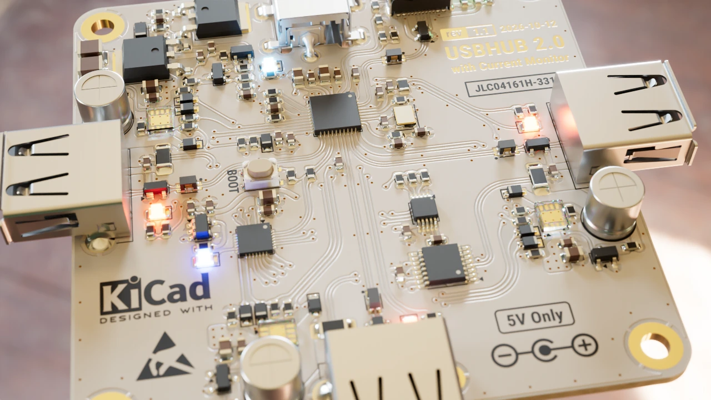
  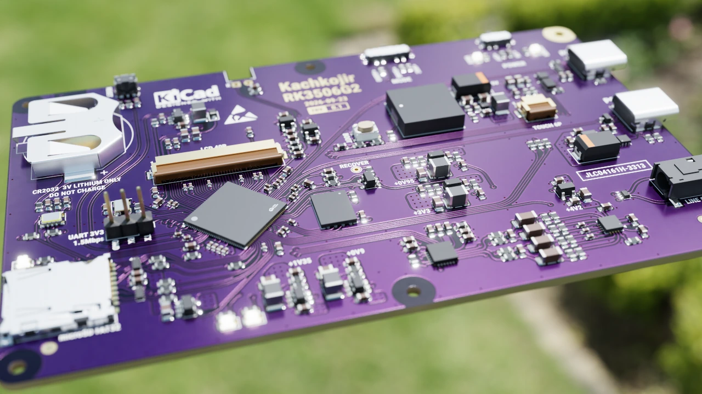
  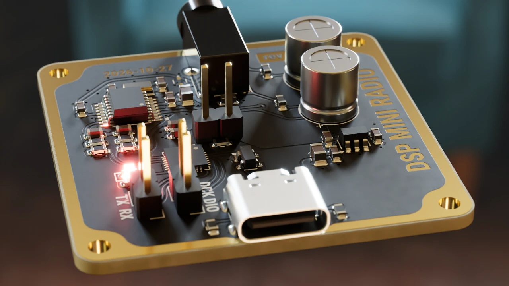
  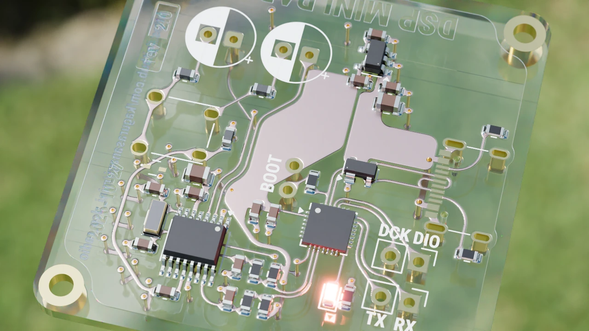
  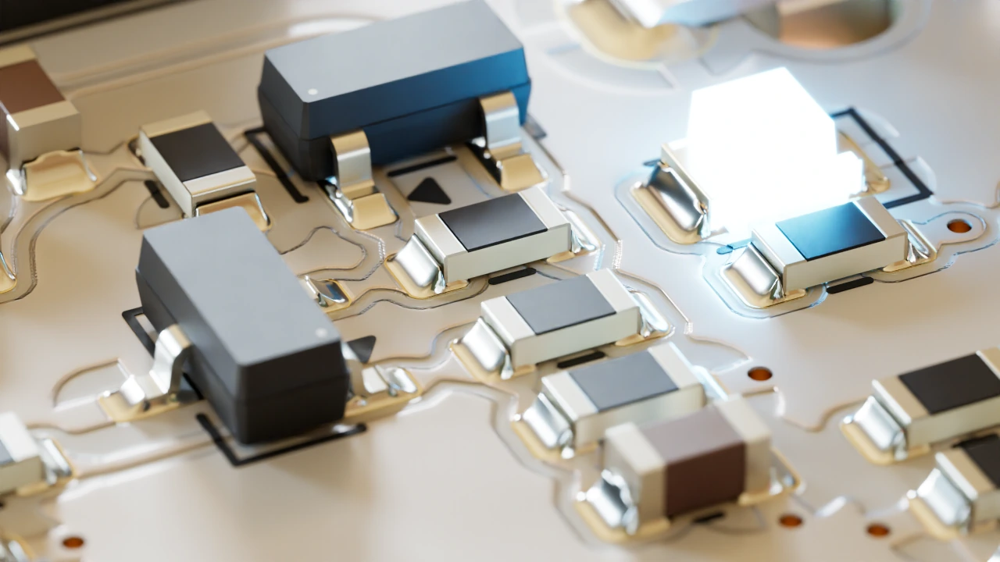
  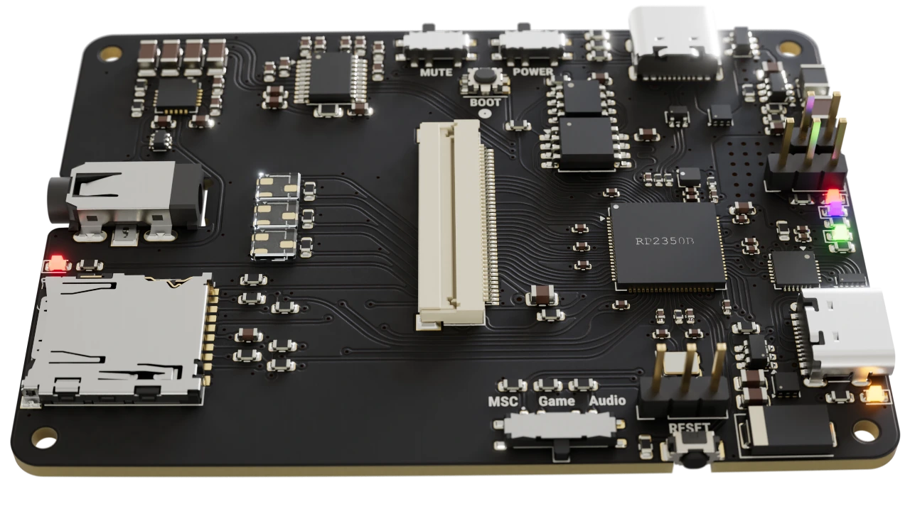

KiCad の 3D ビューアは編集の邪魔をしない簡素な表示なので、もっときれいに眺めたくて作りました。

## できること

- KiCad で保存すると、すぐ描き直す
- レジスト・金メッキ・シルクの質感、はんだの盛り、LED の発光まで写実的に描く
- はんだの形を、パッドと部品の 3D モデルから自動で作る（表面張力の物理シミュレーションで作る高精度モードもある）
- 部品をクリックして材質を変える
- 画像（PNG / EXR。背景を透明にもできる）と、回転する動画（MP4）を書き出す
- KiCad のツールバーのボタンから開く

## 動作環境

- Windows 10 / 11（64 bit）
- Vulkan のレイトレーシングに対応した GPU
  - 快適に使えるのは NVIDIA GeForce RTX 20 系以降
  - GTX 1060 6GB などの GTX 10 系も動きますが、描き直しに十数秒かかります
- KiCad 9 / 10（同じ PC に入れてください。3D モデルと、文字を描く `kicad-cli` を使います）

## インストール

1. [最新版の zip](https://github.com/kagurasanagi/KRB-Renderer/releases/latest) をダウンロード
2. 好きな場所に展開（インストールは不要）
3. `KRB-Renderer.exe` を起動

「PC が保護されました」と出たら、「詳細情報」→「実行」で起動できます（署名のないアプリのため）。

更新は、新しい zip を展開して置き換えるだけです。削除は、KiCad のボタンを外してから（下の「KiCad から開く」で「解除」）フォルダを消します。設定は `%APPDATA%\krbr` に残ります。

## 使い方

### KiCad から開く

1. `KRB-Renderer.exe` を起動し、「設定 → KiCad プラグイン...」で、使っている KiCad の「登録」を押す

   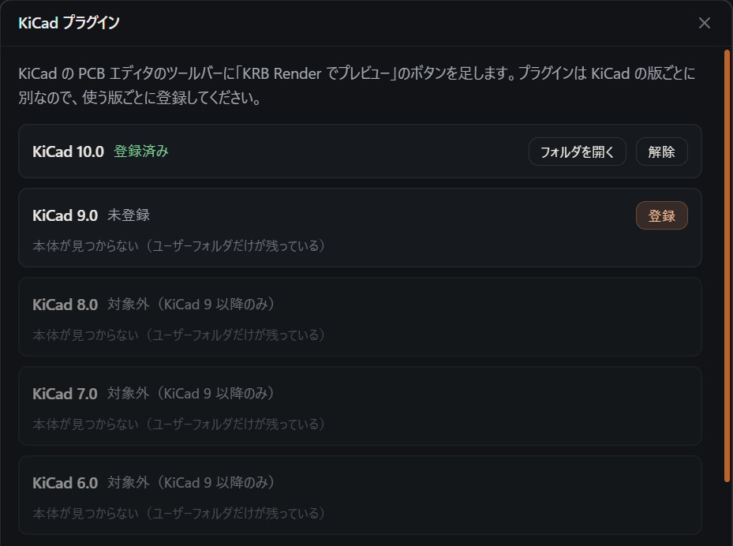

2. KiCad を開き直すと、PCB エディタのツールバーにボタンが出ます。押すと、開いている基板がビューアで開きます

   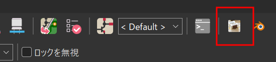

3. あとは KiCad で編集して保存するたびに、自動で描き直します

KiCad を使わずに開くときは、`.kicad_pcb` を `KRB-Renderer.exe` かウィンドウにドラッグ＆ドロップします。

### 画面の操作

`S` で画像を保存します（基板のフォルダへ）。動画は「ファイル → 動画を書き出す…」です。

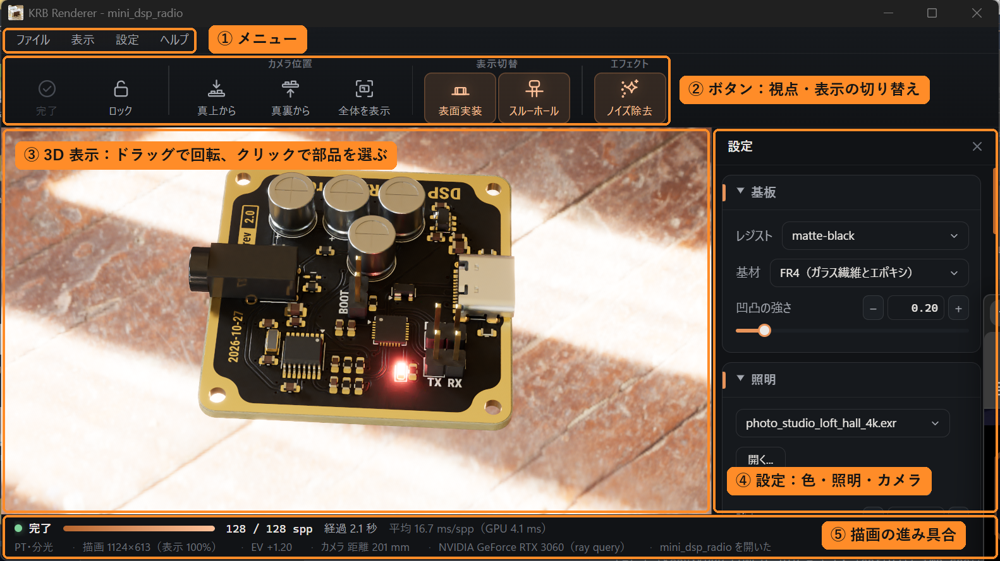

| 操作 | 内容 |
|---|---|
| 左ドラッグ | 回転 |
| 右・中ドラッグ | 移動 |
| ホイール | 拡大・縮小 |
| クリック | 部品を選ぶ |
| Ctrl + クリック | その点にピントを合わせる |
| `F` | 全体を表示 |
| `S` | 画像を保存 |
| `P` | 一時停止 |
| `Esc` | 終了 |

すべてのキーは「ヘルプ」メニューに出ています。

`.kicad_pcb` は書き換えません。視点や材質は、基板の横の `<基板の名前>.krbr` に保存します（git で管理しているなら差分に出ます。「ファイル → 基板の設定ファイルの置き場所」で `%APPDATA%\krbr` に移せます）。

### 材質を変える

部品をクリックし、右の設定パネルの「材質エディタ...」（または `M`）で見本から選びます。

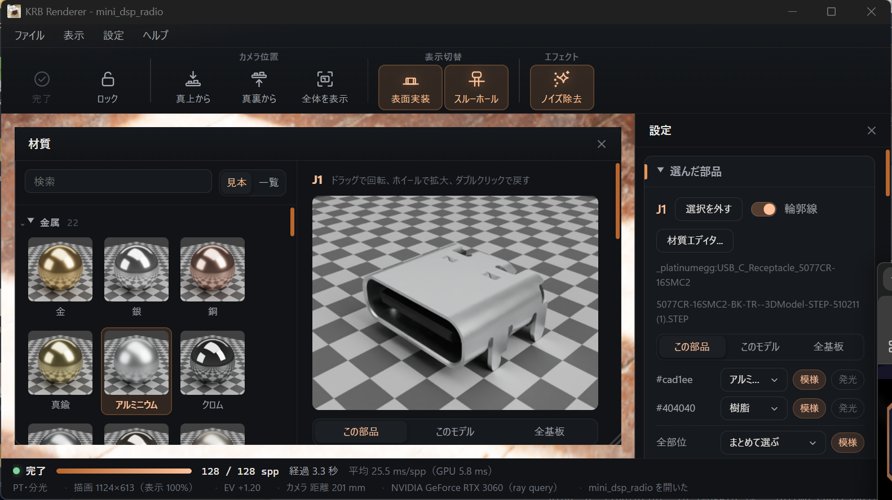

### 背景と照明を変える（HDR 画像）

映り込みと光の当たり方は、周りの景色を写した HDR 画像（環境マップ）で決まります。最初は内蔵のスタジオです。

`.hdr` / `.exr` をウィンドウにドラッグ＆ドロップするか、設定パネルの「照明」の「開く...」で選びます。明るさと向きも「照明」の「強さ」「回転」で変えられます（`[` / `]` でも回せます）。選んだものは基板ごとに覚えます。

「照明」の「背景を透明にする」をオンにすると、基板だけを切り抜いた PNG（アルファ付き）を保存できます。製品ページや資料に貼るときに便利です。

無料で使える HDR 画像の配布先：

- [Poly Haven](https://polyhaven.com/hdris)：数百枚。CC0（商用も可、表記も不要）
- [ambientCG](https://ambientcg.com/list?type=hdri)：空や屋外が中心。CC0
- [HDRMAPS](https://hdrmaps.com/freebies/)：無料の分（Freebies）は商用も可。最大の解像度は有料

解像度は 4K で十分です。8K は GPU のメモリを多く使います。

### はんだの形

はんだの盛り（フィレット）は、パッドとペーストの量、部品の 3D モデルの電極・リードから自動で作ります。作り方は 2 通りで、設定パネルの「はんだを高精度で作る」で切り替えます（基板ごとに覚えます）。

- **標準**（既定）：電極・リードの際で高く、パッドの縁で 0 になる決め打ちの形。基板全体で 0.1 秒ほど
- **高精度**：溶けたはんだが落ち着く形を、表面張力の物理シミュレーション（GPU）で求めます。銅と電極・リードには濡れ広がり、樹脂やレジストには付きません。初めての部品の種類は数十秒〜数分かかりますが、結果はキャッシュに残り、同じ部品はほかの基板でも使い回します

| 標準 | 高精度 |
|---|---|
| 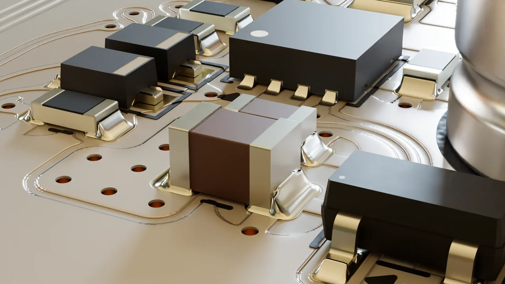 | 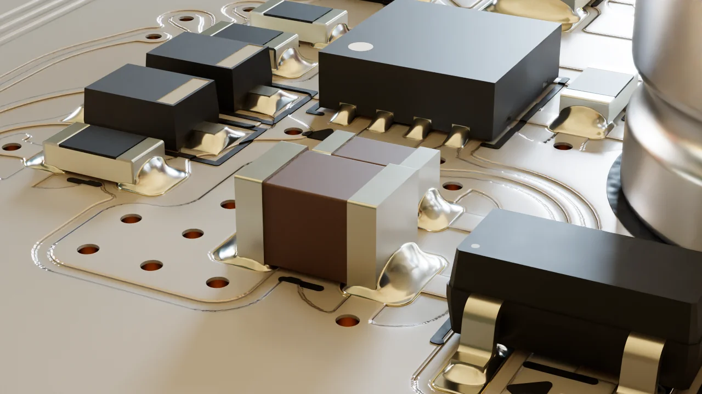 |
| 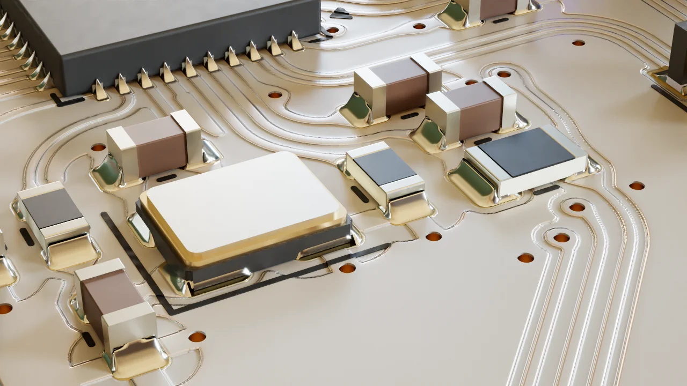 | 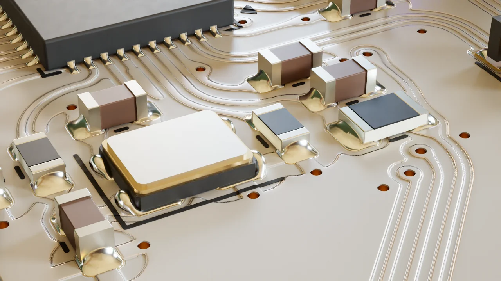 |

詳しくは [使い方の詳細](docs/usage.md) の「はんだフィレット」と、[はんだのシミュレーション](docs/solder_simulation.md) を見てください。

## 困ったとき

- **部品が箱のまま**：3D モデル（STEP / VRML）が見つかりません。KiCad の 3D モデルのライブラリを入れてください（開いた直後は、読み込みが終わるまで箱で出ます）。
- **文字や QR コードが出ない**：KiCad 付属の `kicad-cli` が見つかりません。KiCad を標準の場所に入れてください。
- **操作が重い**：`P` で一時停止すると軽くなります。
- **メニューが出ない**：[WebView2 Runtime](https://developer.microsoft.com/microsoft-edge/webview2/) を入れてください。

解決しないときは [Issues](https://github.com/kagurasanagi/KRB-Renderer/issues) へどうぞ。

## 詳しい説明

- [使い方の詳細](docs/usage.md)：すべての操作、コマンドライン、設定ファイル、材質
- [開発者向け](docs/development.md)：ビルド、テスト、配布の作り方
- [内部の仕組み](docs/internals.md)：処理の流れ、描画のアルゴリズム
- [はんだのシミュレーション](docs/solder_simulation.md)：高精度のはんだの方式、物性値、検証

## ライセンス

MIT。同梱のライブラリのライセンスは、zip の `licenses` フォルダにあります。

## English

A real-time, GPU ray-traced viewer for KiCad 9 / 10 boards on Windows 10 / 11. It re-renders every time you save in KiCad, and can add a button to the PCB Editor toolbar. Solder fillets are shaped from the pads and 3D models; an optional precise mode solves the surface-tension equilibrium of the molten solder on the GPU.
Download the zip from [Releases](https://github.com/kagurasanagi/KRB-Renderer/releases/latest), unzip it, and run `KRB-Renderer.exe`. Needs a GPU with Vulkan ray tracing (GeForce RTX recommended).
The UI is available in English (Settings → Language). License: MIT.
