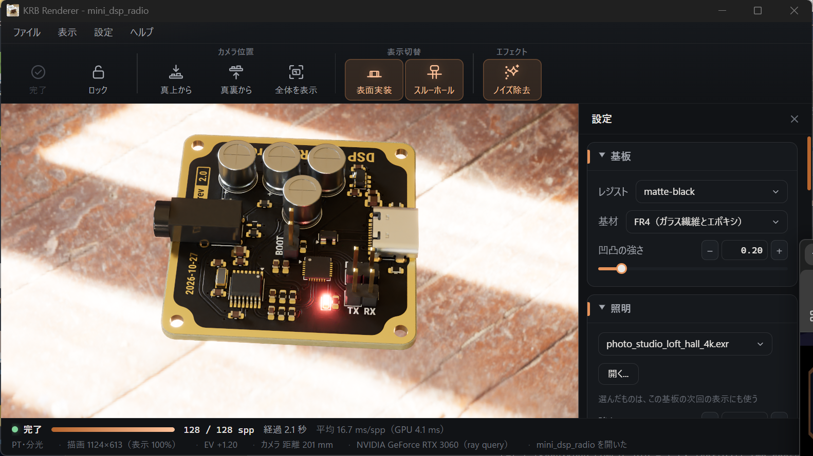
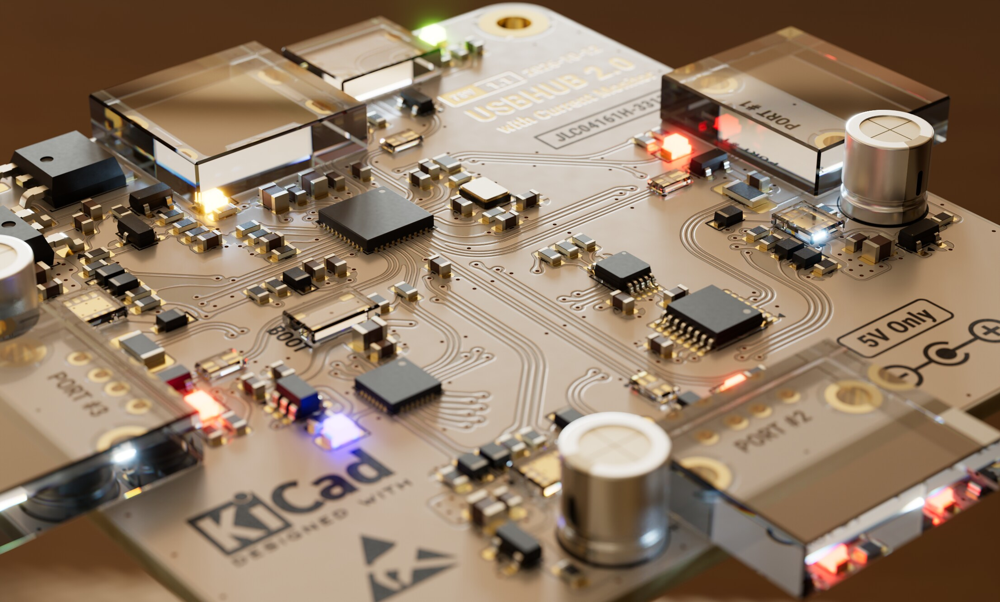
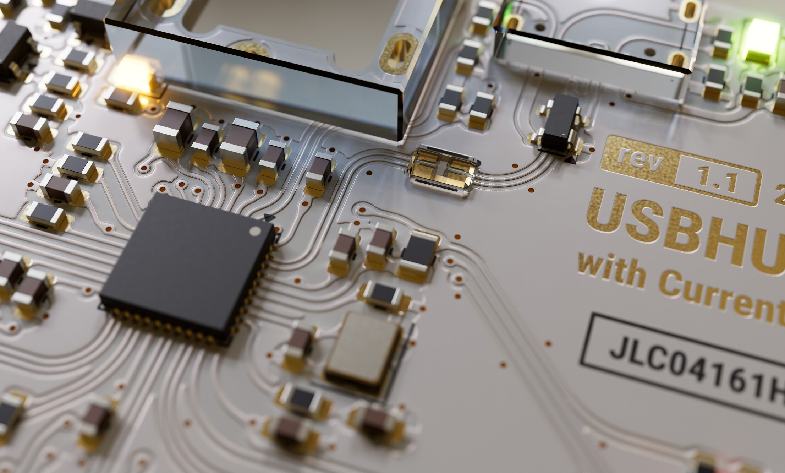

# KRB-Renderer — KiCad 連携 物理ベース レンダラー



<p>
  
  
</p>

**KRB-Renderer**（KiCad 連携 物理ベース レンダラー）は、KiCad の `.kicad_pcb` を読み込み、HDR 環境光で照らした基板を、Vulkan のレイトレーシング（`VK_KHR_ray_query`）を使った GPU パストレーサーで描画するツールです。

コマンド名・設定フォルダ名・環境変数の接頭辞は、短い **`krbr`** のままです（`krbr.exe`、基板の設定ファイル `<基板の名前>.krbr`、`%APPDATA%\krbr\`、`KRBR_CONFIG_DIR` など）。リポジトリ名だけが KRB-Renderer です。

本体は Rust（`rust/`）です。C++ は、OpenCASCADE を使う STEP 変換器 DLL（`step_dll/`）だけに残しています。以前の C++ 版の本体は、タグ `cpp-final` で見られます。

```
# リアルタイム表示（既定。ウィンドウが開く。--hdr は省略できる）
krbr board.kicad_pcb

# ファイルへ出力（ウィンドウは開かない）
krbr render board.kicad_pcb --hdr studio.exr --spp 256 --width 1920 --height 1080 --out out/board.png
```

### リアルタイム表示（`krbr <pcb>` / `krbr view <pcb>`）

フレームごとにサンプルを積み増して表示します。1フレームに積むサンプル数は、GPU のタイムスタンプで測った時間が約 10 ms に収まるように自動で調整します。最大のサンプル数（既定 2^12 = 4096）まで積むと描画を止め、GPU を休ませて入力を待ちます。最大はパネルで 2 の何乗か（2^4 = 16 〜 2^16 = 65536）で選びます。`--spp` を指定すると、それ以上で最も近い 2 の累乗になります。ノイズはサンプル数の平方根でしか減らない（半分にするには 4 倍の時間）ので、1 段上げるごとの変化は小さくなります。

**操作パネル**（ウィンドウの右端に上下いっぱいで固定。幅は境目のドラッグで変え、× で閉じる。上端のメニューの「表示」→「設定パネル」か `F1` / `Tab` で再表示）で、次の項目をその場で変えられます。3D 表示はパネルを除いた領域に描きます。

| 項目 | 内容 |
|---|---|
| 環境マップ | 同じフォルダの `.hdr` / `.exr` から選ぶか、「開く...」でファイルを選ぶ。読み込みは別スレッドで行い、終わったら差し替える |
| 強さ・回転 | 環境マップの明るさと、縦軸まわりの回転 |
| 露出 | EV のスライダー。「自動」は、いまの画像の対数平均輝度を中間の灰色（0.18）に合わせる |
| 凹凸の強さ | 表面の微細な凹凸の倍率（`bump_intensity`） |
| レジスト | レジストの色のプリセット（「設定どおり」か、KiCad の色名／JLCPCB の色）。色・粗さ・散乱をまとめて切り替え、累積をやり直す。基板ごとに覚え、次に開いたときにも使う（下記「前回の設定を覚える」） |
| 表示 | 描画のサイズとレンダリングの比率（下記）、画像 / アルベド / 法線、最大 spp（2 の累乗） |
| カメラ | 画角、視点を戻す、保存 |
| 積分器・レンズ・色の計算 | PT / BDPT / VCM、ピンホール / 薄レンズ / 実レンズ、RGB / 分光 |
| 選んだ部品 | 部品をクリックで選び、部位ごとに材質を割り当てる（下記「ビューアで材質を割り当てる」） |

| 操作 | 内容 |
|---|---|
| 左ドラッグ | 回転（方位・仰角） |
| 右／中ドラッグ | 平行移動 |
| ホイール | 拡大・縮小 |
| `R` / `F` | カメラを初期位置（基板全体が入る構図）に戻す |
| `+` / `-` | 露出 ±0.25 EV（表示だけ。累積はやり直さない） |
| `[` / `]` | 環境マップを ±15° 回す |
| `1` / `2` / `3` | 画像 / アルベド / 法線 の表示 |
| `S` | 現在の累積を、レンダリングの解像度で、基板のフォルダに `<基板の名前>_000.png`（露出・グロー・トーンマッピング済み）と `.exr`（リニア）として保存（番号は保存のたびに増える。ノイズ除去した画像を表示していれば `_denoised` も）。場所と名前は `--out` で変えられる。保存した場所はステータスバーに出る |
| ファイル ＞ PNG として保存... / EXR として保存... | 場所と名前を選んで保存する（ダイアログは基板のフォルダから始まる）。PNG は露出・グロー・トーンマッピング済み、EXR はリニアの放射輝度。ノイズ除去した画像を表示していれば、その画像を保存する |
| `D` | ノイズ除去を今かける（ノイズ除去が CPU のときだけ意味がある。下記） |
| `P` | 一時停止（下記） |
| クリック / Ctrl ＋クリック | 部品を選ぶ / その点にピントを合わせる |
| `Esc` | 終了 |

**描画のサイズとレンダリングの比率**（メニューの「表示」、パネルの「表示」の欄、`--render-size WxH|fit` / `--render-ratio`）：

- 描画のサイズは「ウィンドウに合わせる」か、決まったサイズ（1280×720、1920×1080、2560×1440、3840×2160、1080×1080、1080×1350、1200×800）です。
- レンダリングの比率は、レンダリングの解像度 ÷ 表示の大きさです（×0.25 / ×0.5 / ×1 / ×1.5 / ×2）。
- **決まったサイズ**では、3D 表示の領域が「描画のサイズ ÷ 比率」になるように、ウィンドウの大きさを変えます（例：3840×2160・×2 なら領域は 1920×1080 で、4K で描いて縮小表示）。画面に入らないときは、入るまで比率を上げて知らせます。その後で手でウィンドウの大きさを変えたときは、描画の解像度はそのままで、縦横比を保って領域に収めて表示します。
- **ウィンドウに合わせる**では、レンダリングの解像度は「3D 表示の領域 × 比率」です。×0.5 にすると、1 サンプルの時間が約 1/4 になって操作が軽くなります（表示は拡大するので粗くなる）。
- `S` で保存する画像はレンダリングの解像度です。描画のサイズと比率は基板ごとに覚え、決まったサイズを選んでいれば `render` もその大きさで書き出します（`--width` / `--height` を付けたらコマンドラインが勝つ）。

画面の下端の**ステータスバー**に、次を表示します。

- 1 行目：状態（レンダリング中 / 完了 / 一時停止中）、積んだサンプル数と進み具合、**経過時間**（今の累積を始めてからレンダリングにかかった時間。一時停止の間と完了後は数えず、視点などを変えて累積をやり直すと 0 から）、**1 サンプルあたりの平均**（経過時間 ÷ サンプル数と、GPU がサンプルを描いた時間だけの平均。完了後は変わらない）、残りの予想時間
- 2 行目：積分器と色の計算、描画の解像度と表示の倍率、露出、GPU の名前と方式（ray query / ray tracing pipeline）、読み直し・kicad-cli・3D モデルの分割の状態と、最後の更新の知らせ
**表示の言語**（いまは英語と日本語）は、次の順で決めます。訳の無い言語なら英語で表示します。

1. `--lang ja` か、環境変数 `KRBR_LANG`
2. メニューの「表示」→「言語」で選んだもの（`%APPDATA%\krbr\state.toml` に覚える。「自動」で 3 以降に戻る）
3. KiCad で選んだ言語（`kicad_common.json` の `system.language`。KiCad が「Default」なら次へ）
4. OS の言語

ログとコマンドラインの説明は英語です。KiCad のプラグインのボタンとメッセージは、KiCad の表示の言語に合わせます。翻訳は `rust/crates/krbr-app/i18n/<言語>/krbr-app.ftl`（[Fluent](https://projectfluent.org/) の形式、英語が基準）で、exe に埋め込みます。言語を足すときは、英語のファイルを写して訳し、`krbr-app/src/i18n.rs` の `LANGUAGES` に加えます。

開発用に、非表示のウィンドウで描いて終了するテストモードがあります（`--test-frames N --screenshot path [--test-orbit 度]`）。画面には出ず、フォーカスも奪いません。

### 保存の監視と差分更新

ビューア（`--no-watch` で無効）と `krbr watch` は、`.kicad_pcb` の保存を見張って自動で読み直します。

- 更新日時とサイズを 100 ms ごとに調べ、変化が 200 ms 止まってから読みます（書き込み・置き換えの途中では読まない）。
- 部品・配線・ビア・ベタ・図形ごとに、UUID と S 式のハッシュと範囲を持ち、前回と比べて**変わった項目の新旧の範囲**だけを作り直します（`krbr-kicad` の `diff_boards`）。外形や層構成が変わったときは全体を作り直します。
- 凹凸メッシュは 8 mm 角のタイルに分けて持ち（`krbr-geom` の `ReliefTileCache`）、範囲にかかるタイルだけを並列で作り直します。部品を 1 つ動かすと、200 枚のうち 4 枚程度です。
- 読み直しは裏のスレッドで行います。読み直し中と、変更の件数・作り直したタイルの数・かかった時間は、設定パネルの上に出ます。読み直しの間に変えたレジストの色は、差し替えのときに反映します。
- GPU の形状（BLAS/TLAS）はまとめて作り直します（数十 ms）。環境マップは送り直しません。
- キャッシュにない 3D モデルは、まず箱で表示し、裏の 1 本のスレッドで分割し終えたら差し替えます。
- 線フォントのシルクの文字が変わったときは、kicad-cli による描き直しを裏で行い、それまでは前の文字のままです。
- `krbr watch` はウィンドウを開かずに、保存のたびに `--out`（既定 `out\watch.png`）を書き直します（1 回の更新で積むのは `--spp`、既定 32。`--max-updates` 回で終わる。ノイズ除去は既定で有効、`--no-denoise` で無効）。トーンマッピングを GPU で行い、圧縮しない PNG（書き出しが速い。1080p で約 8 MB）を一時ファイル経由で置き換えます。

計測（RTX 3080 Ti、1920x1080、32 spp）：0603 のコンデンサを 1.5 mm 動かす保存から画像の更新まで約 0.5 秒（監視の待ち 0.2〜0.3、読み直し 0.15（解析 0.05、タイル 4 枚）、GPU 0.04、描画 0.12、書き出し 0.02）。

### ノイズ除去（OIDN）

`krbr-render` の `denoiser` が Intel Open Image Denoise（RT フィルタ、HDR、補助情報としてアルベドと法線）を使います。OIDN の DLL（`OpenImageDenoise.dll` ほか一式）は実行時に読み、exe と同じフォルダの `dll\oidn\`、exe と同じフォルダ、開発中は `<リポジトリ>\third_party\oidn\bin\` の順に探します（無ければノイズ除去だけが使えず、ほかはそのまま動きます）。

- Vulkan のデバイスと同じ GPU（UUID で選ぶ）の CUDA デバイスで動かし、Vulkan のバッファを外部メモリ（Win32 ハンドル、`VK_KHR_external_memory_win32`）として OIDN と共有します。CPU を経由する転送はありません。共有できない環境では CPU デバイスに切り替えます（開発用に `KRBR_DENOISE_DEVICE=cpu` で強制できる）。
- 累積画像をサンプル数で割って入力を作るシェーダ（`denoise_prep.comp`）→ OIDN → 結果を画像へ写し、表示用のトーンマッピングにつなぎます。
- **強さ**：OIDN 自体には強さの設定が無いので、ノイズ除去した画像と元の画像を混ぜる割合として調整します（パネルのスライダー、`--denoise-strength`。0〜1、既定 1 で OIDN の結果そのまま。下げると細部やざらつきが少し残る）。混ぜる処理は軽い（`shaders/denoise_blend.comp`）ので、ビューアではスライダーを動かすとすぐ反映されます。
- ビューア：既定で無効（`--denoise` かパネルの「ノイズ除去 (OIDN)」で有効にする。OIDN の準備は有効にしたときに初めて行う）。カメラを動かしている間は品質 fast で毎フレーム、止まったら high で 150 ms ごと、収束時にもう一度。`S` を押したとき、ノイズ除去した画像を表示していれば `<名前>_NNN_denoised.png / .exr` も書きます（表示と同じ強さ）。
- 速さ（RTX 3080 Ti）：1920x1080 の high で約 14 ms、960x540 で 5 ms。CPU デバイスでは 960x540 で約 0.2 秒です。4 spp の画像をノイズ除去すると、1024 spp の参照との差の平均が約 70% 減ります（RGB・分光とも）。
  - ノイズ除去が **CPU** になるとき（CUDA が使えない GPU。GTX 1060 など）は 1 回に数秒かかり画面が止まるので、ビューアは**収束時（最大 spp に達したとき）と、`D` キー／パネルの「今かける」のときだけ**かけます（常に品質 high）。それ以外は蓄積中のノイズのある画像をそのまま表示します。
- `krbr watch`：既定で有効（high）。`krbr render --denoise` で `<名前>_denoised.png / .exr` も書き出します。`--no-denoise` で無効にできます。

### ファイル出力（`krbr render`）

出力（`--out` と同じフォルダ）:

| ファイル | 内容 |
|---|---|
| `board.png` | グローとトーンマッピング済み（ACES 近似、sRGB） |
| `board.exr` | リニアの放射輝度（RGB float32） |
| `board_albedo.exr` / `board_normal.exr` | 最初の交点のアルベド／ワールド法線（ノイズ除去の補助情報） |
| `missing_models.json` / `missing_models.txt` | 見つからない・読めなかった 3D モデルの一覧 |

## ビルド

配布の zip を使うだけなら、以下はどれも要りません。

前提（いずれも PATH や環境変数で見つかること）:

| もの | 確認したもの | 用途・備考 |
|---|---|---|
| Rust（MSVC の stable） | `rust/rust-toolchain.toml` で指定 | 本体 |
| Vulkan SDK（`glslc`） | 1.4.350（`VULKAN_SDK`） | シェーダ（GLSL → SPIR-V）。`krbr-render` の `build.rs` が、環境変数 `GLSLC`、`%VULKAN_SDK%\Bin`、PATH の順に探す |
| Visual Studio 2022/2026 の C++ ツール | VS 2026 Build Tools 18.10（MSVC 14.51） | Rust のリンカと、STEP 変換器 DLL。`scripts\build.cmd` が vswhere で探す。Community でも Build Tools でもよい |
| CMake 3.25 以上、Ninja | 4.2、1.13（`winget install Ninja-build.Ninja`） | STEP 変換器 DLL だけ。Ninja は VS 同梱 → PATH → winget の順で探す（Build Tools には同梱されない） |
| vcpkg | `VCPKG_ROOT`（無ければ `%USERPROFILE%\vcpkg`） | STEP 変換器 DLL の OpenCASCADE と glm。マニフェストの baseline のコミットがローカルの vcpkg にあること（無ければ `git -C %VCPKG_ROOT% pull`） |
| KiCad 10 | `C:\Program Files\KiCad\10.0` | 3D モデルの既定フォルダと kicad-cli（シルクの線フォント）。実行時に使う |

```
cd rust
cargo build --release                    # krbr.exe と、シェーダ（rust\target\release\shaders）
cd ..
scripts\build.cmd                        # STEP 変換器 DLL（build\release\step）。初回は vcpkg が OpenCASCADE をビルドするので時間がかかる
scripts\build.cmd --clean                # build\release を消してやり直す（それ以外の引数は cmake --build に渡す）
powershell -File scripts\get_oidn.ps1    # ノイズ除去（OIDN 2.5.1 の公式バイナリ）を third_party\oidn へ。無くても動く
rust\target\release\krbr.exe probe
```

STEP 変換器 DLL と OIDN が無くても krbr.exe は動きます（STEP のモデルは代替の箱、ノイズ除去は使えない）。

| ライブラリ | 用途 |
|---|---|
| ash, gpu-allocator | Vulkan（ローダーは動的読み込み） |
| winit, egui（egui-winit, egui-ash-renderer）, rfd | ビューアのウィンドウ・入力と操作パネル、ファイルを開くダイアログ |
| clipper2, earcut | 多角形の和・差・オフセット、三角形分割 |
| exr, image | EXR/HDR の入出力、PNG 出力 |
| toml, serde_json, clap, glam, xxhash-rust | 設定・レポート・コマンドライン・数学・キャッシュのキー |
| libloading | STEP 変換器 DLL と OIDN を実行時に読む |
| Intel Open Image Denoise 2.5.1 | ノイズ除去。公式のビルド済みバイナリ（Apache-2.0）を `third_party/oidn` に置く（`scripts/get_oidn.ps1`、git には含めない）。実行時に読む |
| OpenCASCADE 8.0（TKDESTEP / TKXCAF / TKMesh / TKRWMesh） | STEP の読み込みと三角形分割（面の色つき）。**変換器 DLL `krbr_step.dll` の中だけで使い**、本体はリンクしない（下記） |

## コマンド

| コマンド | 内容 |
|---|---|
| `krbr probe` | Vulkan デバイスとレイトレーシング拡張の確認、ヘッドレスデバイスの作成 |
| `krbr info <pcb> [--models]` | 基板の解析結果と 3D モデルのパス解決の確認（GPU は使わない） |
| `krbr <pcb> --hdr <file>`（= `krbr view`） | リアルタイム表示 |
| `krbr render <pcb> --hdr <file> [options]` | ファイルへ出力 |
| `krbr watch <pcb> --hdr <file> [--out out/watch.png] [--spp 32]` | ヘッドレス：保存のたびに描き直して PNG を書き出す（ウィンドウは開かない） |
| `krbr material list` | 材質ライブラリの一覧 |
| `krbr mask list` | レジストの色のプリセット一覧（KiCad の色名と、JLCPCB の選択肢） |
| `krbr material show <pcb> [--ref U3]` | 部品・部位ごとの材質と、どの段階で決まったか |
| `krbr material set <pcb> --ref U3 [--part K] --material M` | 部品番号ごとの上書き（基板の設定ファイル `<名前>.krbr` の `[ref.U3]`） |
| `krbr material set <pcb> --model <パス/ファイル名> [--part K] --material M [--global]` | 3D モデルごとの設定（プロジェクト、または `--global` で全体設定） |
| `krbr kicad-plugin install` / `uninstall` | KiCad の PCB エディタに「KRB Render でプレビュー」のボタンを足す・消す（下記「KiCad のプラグイン」） |
| `krbr bench <pcb> [--spp 64] [--width 1920 --height 1080]` | 同じ条件でレンダリングの速さを測る（GPU を替えたときの比較用。下記） |
| `krbr geom <pcb>` / `krbr models <pcb>` | 開発用：基板の形状と凹凸タイル（GPU を使わない）／全 3D モデルの読み込みの統計 |
| `krbr diff <a> <b>` | 開発用：2 枚の画像（PNG / EXR）の差の平均と最大 |

`render` の主なオプション: `--spp`（既定 64）, `--width/--height`, `--elevation`（既定 35°）, `--azimuth`（既定 45°）, `--fov`, `--look-at X Y`（KiCad の座標の点を注視）, `--zoom`（自動の構図からの拡大率）, `--exposure`, `--env-intensity`, `--env-rotation`, `--max-depth`, `--clamp`, `--integrator pt|bdpt|vcm`, `--seed`, `--spectral` / `--rgb`（色の計算）, `--mask-color <プリセット名 または r,g,b>`（レジストの色。下記）, `--lens pinhole|thin|realistic`, `--f-number`, `--focal-length`, `--focus-distance`, `--blades`, `--denoise` / `--no-denoise` / `--denoise-strength`, `--init`, `--no-cache`, `--no-kicad-cli`, `--validate`, `--normal-priority`, `-v`。

### 速さの計測（`krbr bench`）

GPU を替えたときなどに、同じ条件でレンダリングの速さを測ります。覚えた設定（パネルの設定・視点・環境マップ）は使わず、条件を固定します：1920x1080、内蔵のスタジオ、自動の構図（仰角 35°・方位 45°・画角 30°）、ピンホール、露出 0、乱数の種 0、ノイズ除去なし。PT（RGB）・PT（分光）・BDPT・VCM のそれぞれで、準備の 8 サンプル（測らない）の後、`--spp`（既定 64）サンプルの時間を測ります。基板の読み込みとシーンの準備の時間は含みません。CPU の優先度は下げません。

結果は `%APPDATA%\krbr\bench.csv` に追記します（日時、GPU、ドライバ、方式、基板とその内容のハッシュ、条件、1 サンプルあたりの時間）。同じ基板（内容が同じもの）・同じ条件で別の GPU の記録があれば、最後のものと比べて何倍速いかを表示します。GPU を替える前に一度測っておけば、替えた後に同じコマンドで比べられます。最大の深さなど設定ファイルの項目は使うので、比べる間は設定ファイルを変えないでください。

## GPU の要件と、GTX 1060 での状況

描画には Vulkan 1.3 と `VK_KHR_acceleration_structure` に加えて、**`VK_KHR_ray_query` か `VK_KHR_ray_tracing_pipeline`** のどちらかが必要です。交差判定は `shaders/scene.glsl` の `rawTraceClosest` / `rawOccluded` に閉じていて、GPU に応じて次のどちらかで作ります（本文のシェーダは同じ。`shaders/stage.glsl` で切り替え）。

| 方式 | 使う GPU | 仕組み |
|---|---|---|
| ray query（優先） | RTX など `ray_query` を持つもの | 計算シェーダの中で `rayQueryEXT` を辿る（`<名前>.comp.spv`） |
| ray tracing pipeline | GTX 10 系など `ray_query` が無いもの | 同じ本文をレイ生成シェーダとして組み（`<名前>.rgen.spv`、`-DKRBR_RT_PIPELINE`）、`traceRayEXT` → 最近接ヒット `rt_hit.rchit`（交点の生の情報をペイロードへ）／ミス `rt_miss.rmiss`／影用ミス `rt_shadow.rmiss`。再帰はせず、シェーダバインディングテーブルは `krbr-render` の `kernel.rs` が組む |

| GPU | 状況 |
|---|---|
| RTX 3080 Ti（開発元の PC） | ray query。README の時間の数値はここで測ったもの |
| GTX 1060 6GB（別の開発用の PC、ドライバ 581） | `ray_query` なし → ray tracing pipeline。RT コアが無いのでドライバのエミュレーションで、RTX より大きく遅い（下記） |

`krbr probe` でどちらになったかを表示します（`GPU: ... ray tracing pipeline (no ray_query)`）。

GTX 1060 での実測（kachkojir_RK3506G2、135 万三角形、PT、深さ 8）：

| 項目 | 時間 |
|---|---|
| `render` 640x360 | 40 ms/spp |
| `render` / `watch` 1920x1080 | 約 180〜200 ms/spp（32 spp で 6 秒前後） |
| ノイズ除去 1080p（OIDN、CPU の high） | 6〜8 秒 |
| 保存から画像の更新（watch テスト、32 spp、ノイズ除去込み） | 13〜16 秒（RTX 3080 Ti では約 0.5 秒） |

白い炉テスト・積分器の一致・プリズムの分散・カメラの GPU のテスト（下記「テスト」）は、GTX 1060（ray tracing pipeline 版）で、すべての値が以前の C++ 版と表示の桁まで同じでした。また C++ 版のときに、ray tracing pipeline 版と ray query 版で同じ値になることを確かめています。watch テストの「保存から 1 秒以内」は、`ray_query` を持つ GPU が無い PC では 30 秒に緩めています（仕組みの検証が目的のため）。

そのほか、GTX 1060 では OIDN の CUDA デバイス（Volta 以降が必要）が使えないので、ノイズ除去は CPU（Xeon E3-1290 V2、AVX2 なし）で行われ、1080p の high で 6〜8 秒かかります。VRAM が 6 GB なので、環境マップは 8k ではなく 4k を使ってください。

## STEP 変換器 DLL（`krbr_step.dll`）

STEP の読み込み・三角形分割だけが OpenCASCADE（C++ のライブラリ）を必要とするので、その部分を C の API 1 つの DLL に切り出しています。リポジトリの C++ はこれだけです（`step_dll/`、`CMakeLists.txt`、`vcpkg.json`）。

- `step_dll/krbr_step.cpp`：`krbr_step_to_mesh_file(step, 弦の許容誤差, 角度の許容誤差, 出力.krbm, err, len)`。OpenCASCADE に触るのはこのファイルだけ
- 出力は `.krbm`（`step_dll/mesh_file.hpp`、Rust 側は `krbr-model` の `mesh_file.rs`。頂点・法線・添字・三角形ごとの部位番号・部位の名前と色）。メッシュキャッシュと同じ形式
- `scripts\build.cmd` で `build\release\step\` に、DLL と OpenCASCADE の DLL 一式（24 本）を作ります
- krbr.exe（`krbr-model` の `library.rs`）は、`dll\step\krbr_step.dll`、`step\krbr_step.dll`（どちらも exe と同じフォルダ）、開発中は `<リポジトリ>\build\release\step\krbr_step.dll` の順に探し（exe のフォルダから上へたどるので、`deps\` に置かれるテストの実行ファイルからも見つかる）、必要になったときに読み込みます。無ければ STEP を「読めない」扱い（代替の箱）で動きます。API と形式の版を照合します

## 作業中の PC への配慮

- `render` / `probe` / `info` では、ウィンドウ・サーフェス・スワップチェーンを作りません。画像を自動で開くこともしません。
- `view` は収束したら（`--spp` に達したら）描画を止めて入力を待つので、表示したままでも GPU をほとんど使いません。
- CPU の優先度：ウィンドウを持たないコマンド（`render` / `watch` / `geom` / `models`）は、プロセス全体を BELOW_NORMAL で動かします（`--normal-priority` で通常に戻す）。ビューアはプロセスとウィンドウのスレッド（入力・パネル・GPU への投入）を通常のままにし、裏の処理（読み直し・凹凸タイルの作り直し・3D モデルの分割・環境マップの読み込み）のスレッドだけを BELOW_NORMAL にします。ほかのアプリが CPU を使っていても、一時停止などの操作への反応は遅れません。kicad-cli は BELOW_NORMAL で、コンソールを出さずに起動します。
- GPU は、`render` では**グラフィックスを持たない計算専用キュー**を使います。`view` では、画面へ表示できるキューを使います。どちらも `VK_KHR_global_priority` が使えれば **LOW** で作ります。
- 1 サンプルずつ投入して完了を待つので、GPU を長時間占有しません。既定のサンプル数は 64 です。
- `.kicad_pcb`、KiCad のライブラリ・設定は読み取りのみです。
  - kicad-cli はプロジェクトフォルダに `.kicad_prl` を作るので、基板を**一時フォルダへコピーしてから**呼び出します。
- プロジェクトフォルダに書くのは、基板の設定ファイル `<名前>.krbr`（置き場所を「基板の横」にしているとき）と、ビューアで `S` を押したときの画像だけです。`<名前>.krbr` は、`--init`、材質の割り当て、ビューアで覚えた設定のときに書き、手で書いた表とコメントは残します。

## 設定ファイル

| 場所 | 内容 |
|---|---|
| `<基板のフォルダ>\<基板の名前>.krbr`（または `%APPDATA%\krbr\boards\`。下記） | 基板ごとの設定をすべて 1 つの TOML に入れる（下の表） |
| `%APPDATA%\krbr\settings.toml` | 全体の設定（`board_settings`：基板の設定ファイルの置き場所） |
| `%APPDATA%\krbr\state.toml` | 基板によらない記憶（最近使った環境マップ、ビューアのウィンドウ） |
| `%APPDATA%\krbr\materials\*.toml` | 名前付きの材質（OpenPBR）。組み込みの材質に、書いた項目だけ重ねる |
| `%APPDATA%\krbr\model_map.toml` | 3D モデルごとの材質（他のプロジェクトと共有）と、色・名前の規則 |
| `%LOCALAPPDATA%\krbr\cache\meshes\` | STEP の分割結果のキャッシュ（キーはファイル内容の XXH64 ＋分割パラメータ） |
| `%LOCALAPPDATA%\krbr\cache\silk\` | kicad-cli によるシルク SVG のキャッシュ |

ファイルが無ければ既定値を使います。優先順位は「コマンドライン ＞ ビューアで覚えた設定 ＞ 設定ファイル ＞ 既定値」です。

**基板の設定ファイル `<名前>.krbr`**（`krbr-scene` の `board_file.rs`）：

| 表 | 内容 | 書くのは |
|---|---|---|
| `[board]` `[relief]` `[surface]` `[placeholder]` `[paths]` `[kicad_cli]` | 表面処理、レジスト・シルク・基材の色、距離場の解像度、凹凸の厚み、代替の箱、モデルのパスの変数・追加検索フォルダ、kicad-cli | 人（`--init` でひな形） |
| `[environment]` `[camera]` `[render]` `[lens]` | 環境マップ・強さ・回転、カメラ、解像度・spp・露出・グロー・積分器、レンズ | 人（`--init` でひな形） |
| `[ref.<部品番号>]` `[[model]]` | 材質の上書き（部品番号ごと・3D モデルごと） | ビューア、`krbr material set` |
| `[remembered]` | ビューアで最後に使った設定（環境マップ、パネルの設定、視点）。消すと上の表の値に戻る | ビューア（`--hdr` を付けた `render` も環境マップを） |

- ファイルが無いときは、ツールが書く必要ができたときに、説明つきのひな形（値は既定値と同じ）から作ります。書き換えるのはその表だけで、手で書いた値・コメント・並びは残します（`toml_edit`）。書式の誤りで読めないファイルには触らず、警告します。
- 中の相対パス（`hdr`、`lens_file`、`model_search_dirs`）は、置き場所によらず基板のフォルダからです。
- **置き場所**：ビューアの「ファイル」→「基板の設定ファイルの置き場所」で、「基板の横」（既定）か「全体設定のフォルダ（`%APPDATA%\krbr\boards\<名前>_<基板のパスのハッシュ>.krbr`。KiCad のフォルダにファイルを増やさない）」を選びます（`settings.toml` の `board_settings = "board"` / `"config_dir"`。すべての基板に効く）。開いている基板のファイルはすぐ移し、ほかの基板のものは次に開いたときに移します。「基板の設定ファイルを表示」でエクスプローラーで開けます。
- **以前の形からの移行**：`<名前>.krbr\` フォルダ（`board.toml` / `environment.toml` / `overrides.toml`）は、見つけたら 1 つのファイルにまとめ、フォルダは `<名前>.krbr.old` に名前を変えて残します（無かったファイルの分はひな形で埋める。フォルダからの相対パスだった `hdr` / `lens_file` は絶対パスにする）。`state.toml` に基板ごとに覚えていたもの（`[boards."<パス>"]`）も、その基板を開いたときに `[remembered]` へ移します。
- 1 つのファイルにした理由：以前は、手で書く設定とツールが書き換える設定をファイルで分けていました（書き換えでコメントが消えないように）。表だけを書き換えるようにしたので分ける必要がなくなり、基板と一緒に持ち運ぶ・バージョン管理するのに 1 つの方が扱いやすいためです。ビューアで覚えた設定も入るので、視点などを変えるたびにファイルが書き換わります（git で管理しているなら差分が出ます）。

### レジストの色

レジストの色は次の順で決まります：`--mask-color` ＞ ビューアで選んで覚えたもの ＞ `<名前>.krbr` の `[board] mask_color` ＞ `.kicad_pcb` の stackup の色（KiCad の基板設定で選んだ色）＞ 緑。

`mask_color` と `--mask-color` には、sRGB の値（`[r, g, b]` / `r,g,b`）のほかに**プリセット名**を書けます。プリセットは色だけでなく、コートの粗さ（光沢／つや消し）と顔料の散乱（透明さ）もまとめて設定します。一覧は `krbr mask list`。

| プリセット | 内容 |
|---|---|
| `green` `red` `blue` `yellow` `purple` `black` `white` `matte-black` | KiCad の stackup の色名と同じもの。stackup に色があれば自動でこれが使われる |
| `jlcpcb-green` `jlcpcb-purple` `jlcpcb-red` `jlcpcb-yellow` `jlcpcb-blue` `jlcpcb-white` `jlcpcb-black` `jlcpcb-matte-black` `jlcpcb-matte-green` | JLCPCB の注文時に選べる色。白・黒は不透明寄り、matte は粗さを上げてある |

ビューアでは操作パネルの「表面」→「レジスト」でその場で切り替えられます（材質だけを送り直すので一瞬で、累積はやり直し）。

プリセットはシルクの色も決めます：黄・白のレジストでは黒、それ以外では白（`silk_color` を書いていればそちらが優先）。

名前の大小・区切りは無視します（`JLCPCB Purple`、`jlcpcb:purple` も同じ）。メーカーの色は写真からの目分量で、実測ではありません。プリセットの後に `mask_roughness` / `mask_scatter` を書けば、その項目だけ上書きできます。

```
krbr render board.kicad_pcb --hdr studio.exr --mask-color jlcpcb-purple
```
全体設定とキャッシュの場所は、環境変数 `KRBR_CONFIG_DIR` / `KRBR_CACHE_DIR` で差し替えられます（テストで使用）。

### 材質システム

材質は OpenPBR Surface のパラメータで書きます（`krbr-scene` の `material.rs`、色はリニア）。分散は `transmission_dispersion_abbe_number` と `transmission_dispersion_scale` で指定し、`specular_ior` を nd として扱います。アッベ数で表せない材質は、`[material.<名前>.krbr]` に Sellmeier の係数（`sellmeier_b`, `sellmeier_c`）を書けます。

```toml
# %APPDATA%\krbr\materials\my.toml
[material.epoxy_matte]
base_color = [0.02, 0.02, 0.02]
specular_roughness = 0.6
[material.epoxy_matte.krbr]
bump_pattern = "noise"
bump_strength = 0.015
bump_scale = 0.1
```

3D モデルの部位（STEP の XDE の名前、または面の色）ごとに、次の順で材質を決めます。

1. 部品番号ごとの上書き（基板の設定ファイル `<名前>.krbr` の `[ref.U3]`）
2. 3D モデルごとの上書き（`<名前>.krbr` の `[[model]]`）
3. 3D モデルごとの設定（全体の `model_map.toml` の `[[model]]`。他のプロジェクトと共有）
4. 色・名前の規則（全体の `model_map.toml` の `[[rule]]`、次に組み込みの規則）
5. 既定値

- 3D モデルは、展開前のパス（`path`）か、ファイル内容の XXH64（`hash`）のどちらかが一致すれば同じとみなします。ファイルを別の場所に移しても、中身が同じなら設定が効きます。
- 部位のキーは、XDE の名前、`kicad:<色名>`（KiCad 標準モデルの色。例 `kicad:metal_grey_pins`、`kicad:black_body`）、`#rrggbb`（STEP に書かれた色）です。`"*"` は全部位に一致します。
- 材質ライブラリで `base_color` を書かない材質は、3D モデルの面の色を使います。
- 組み込みの規則の先頭は、KiCad 標準のアルミ電解コンデンサのモデル用です（ファイル名が `CP_Radial_D*` / `CP_Elec_*`）。金属色の部位（缶と上面）を `aluminum`、ラジアルの帯（`kicad:light_brown_body`、スリーブへの印刷）を `plastic` にします（色で決める規則だけだと、上面が錫、帯がセラミックになるため）。タンタル（`CP_Radial_Tantal_*`）は対象外です。
- 材質名の後ろに `+smooth` を付けると、表面の模様（凹凸と粗さのむら）を無くした版になります（例 `plastic+smooth`。`krbr material set --material plastic+smooth`、ビューアの部位ごとの「模様」のチェック）。
- 材質名の後ろに `+emit=#rrggbb,<輝度>` を付けると、その色（sRGB。`#` は省略可）と輝度（cd/m²）で光る版になります（LED の点灯など。例 `plastic+emit=#ff0000,5000`。`+smooth` と組み合わせられる）。部品ごとに別の色にするなら、部品番号ごとの上書きに書きます（`krbr material set <pcb> --ref D4 --part kicad:white_body --material "plastic+emit=#ff0000,5000"`、ビューアの部位ごとの「発光」のチェック）。光るのは面の表側だけで、周りの基板や部品も照らします。KiCad 標準の `LED_0603_1608Metric` などでは、光らせる本体は `kicad:white_body` です（`kicad:green_body` は外から見えない部位）。
  - 光っている部位の地の色（拡散の反射率）は、発光の色にします（最も明るい成分を 0.7。色のついた拡散レンズ）。白い地のままだと、周りの光を白く返して発光の色が薄まるためです。
  - 明るさの目安（露出 0.7 EV）：1000〜2000 で色を保ったまま点灯して見え、上げるほど芯がオレンジ〜白に寄ります（ACES のトーンマッピングは、明るすぎる色を白へ向かわせる。実際のカメラで撮った LED と同じ）。グロー（下記）でにじませるには、しきい値（既定 4）を超える明るさが要ります。ビューアで発光を付けたときの既定は 5000 です。
- **透過（`transmission_weight`）**：ガラス・アクリルのような誘電体の屈折（粗さのある GGX の透過、Walter et al. 2007）。中では `transmission_color` / `transmission_depth` で吸収されます（depth が 0 なら、面を通るたびに色をかける）。閉じた形状で、面の向き（三角形の巻き方）が外向きであることを前提にしています。
- **subsurface**：krbr では簡易な形で扱います。`subsurface_weight` の割合で光が拡散して中へ入り、`subsurface_radius`（mm）進むと `subsurface_color` の透過率になる吸収を受けながら進み、反対側の面やふちから拡散して出ます（FR4 の透光性に使用）。
- fuzz・thin_film・anisotropy・geometry_opacity・thin_walled・transmission_scatter は値を GPU まで渡していますが、描画には反映していません（使われるとログで知らせます）。発光（`emission_luminance`、cd/m²）は、放射輝度 1.0 = 1000 cd/m² として描きます。発光は片面（三角形の巻き方で決まる表側）から、余弦分布で放たれます。発光する三角形は光源として直接サンプリングします（輝度 × 面積に比例して選ぶ）。

## そのほかの機能

**グロー（光のにじみ）**：点灯した LED など、とても明るい光が周りへにじむ様子を、トーンマッピングの前に足します（`krbr-render` の `glow.rs` と `shaders/glow.comp`）。Blender の Glare（Fog Glow）や Unreal の Bloom と同じ考え方の後処理で、光った物が「光って見える」のは主にこのにじみによります。

- 露出をかけた後の RGB の最も明るい成分がしきい値を超えた分だけを、半分ずつ縮めた画像の段（ピラミッド。最大 8 段、一番小さい段の短い辺が 4 画素以上）でぼかし、色を保って重ねます（Jimenez 2014 の方式）。輝度ではなく成分の最大で比べるので、色の濃い光（赤い LED）も白く飛ぶ前からにじみます。
- 3 つの値で調整します。どれも基板ごとに覚え、表示と、保存する PNG（`S`・`render`・`watch`）の両方にかかります（EXR（リニア）にはかからない）。

| パネル | コマンドライン / `<名前>.krbr` の `[render]` | 既定 | 内容 |
|---|---|---|---|
| グロー | `--glow` / `glow` | 1 | 強さ。にじんだ光の量（しきい値を超えた分に対する割合）。0 でなし |
| しきい値 | `--glow-threshold` / `glow_threshold` | 4 | これより明るい光だけがにじむ（露出をかけた後の値。1 が画面の白）。白い基板・部品や、環境マップの映り込みまで光るときは上げる |
| 広がり | `--glow-spread` / `glow_spread` | 0.7 | 段を 1 つ大きくするごとの重み（0..1）。小さいと光のすぐ近くに締まり、1 で画面の大きさ近くまで薄く広がる。にじんだ光の総量は変わらない |

- 発光の輝度としきい値の関係：発光面の明るさは、画面の白の「輝度 ÷ 1000 × 2^露出」倍です（5000 cd/m²・露出 0.7 EV なら約 8 倍）。これがしきい値を超えるとにじみます。
- 表示（GPU）と保存（CPU）は同じ式で、画素の差は 1/255 以内です（`tests/glow.rs`）。
- ぼかしの広がりは画像の大きさに比例するので、表示と、解像度の違う保存の画像でも見た目はそろいます。

**前回の設定を覚える**：ビューアのパネルで変えた設定は、基板の設定ファイル `<名前>.krbr` の `[remembered]` に覚え、次に開いたときにも使います（変えてから 1 秒後と終了時に書く）。同じファイルの手で書く表（`[render]` など）は書き換えません。

| 覚える項目 | 単位 | render / watch にも使うか |
|---|---|---|
| 環境マップ（ファイル・強さ・回転）、露出、グロー（強さ・しきい値・広がり）、積分器、レンズ（種類・F 値・ピント・焦点距離・羽根・周辺減光・口径食・色収差）、色の計算（RGB / 分光）、凹凸の強さ、レジストの色、画角 | 基板ごと | 使う |
| 視点（注視点・距離・仰角・方位） | 基板ごと | 使う（`--look-at` / `--zoom` を付けたら自動の構図、`--elevation` / `--azimuth` はコマンドラインが勝つ） |
| ノイズ除去のオン・オフと強さ、最大 spp、表示モード（画像 / アルベド / 法線）、レンダリングの比率 | 基板ごと | ビューアだけ |
| 描画のサイズ（決まったサイズのとき） | 基板ごと | 使う（`--width` / `--height` が勝つ） |
| ウィンドウの大きさ・位置・最大化、設定パネルを出すかとその幅 | 全体で 1 つ | ―（`--width` / `--height` を付けたらその大きさ。前回の位置が今の画面の外なら使わない） |

- 使う順番は、コマンドライン → 覚えたもの → 設定ファイル → 既定値です（`--rgb` は覚えた分光モードを打ち消す）。
- 項目ごとに覚えたときの設定ファイルの値も残し、後で設定ファイルのその項目を書き換えたときは、設定ファイルの方を使います。
- 一時停止と選んだ部品は覚えません（起動時から止めるなら `--paused`）。
- 「視点を戻す（R）」は、設定ファイルとコマンドラインの仰角・方位・画角での自動の構図に戻します。
- メニューの「表示」→「設定をすべて既定に戻す」で、パネルの設定と視点を設定ファイルとコマンドラインの値に戻し、その基板について覚えたもの（環境マップも含む）を消します。ウィンドウの大きさ・位置はそのままです。

**環境マップ**：`--hdr` は省略できます。次の順で決めます。

1. `--hdr`（`render` / `view` とも）
2. その基板で最後に使ったもの（`--hdr` で指定したもの、ビューアで選んだもの）
3. `<名前>.krbr` の `[environment] hdr`
4. 内蔵の **スタジオ**（`builtin:studio`）：灰色の撮影ブースに大きなソフトボックスを置いた環境を、その場で生成します（ファイル不要）。`--hdr builtin:studio` や `hdr = "builtin:studio"` でも指定できます

最後に使ったものは、基板ごとに `<名前>.krbr` の `[remembered]` に、最近使った一覧は `state.toml` に覚えます。覚えた後に `[environment] hdr` を書き換えたときは、そちらを使います。覚えたファイルが無くなっていたら 3・4 に戻ります。設定ファイルで指定したファイルが読めないときは、内蔵のスタジオで代えて続けます（`--hdr` で指定したものが読めないときはエラー）。ビューアの「環境マップ」の一覧には、内蔵のスタジオ、最近使ったもの、今のものと同じフォルダの `.hdr` / `.exr` が出ます。「開く...」でファイルを選ぶか、`.hdr` / `.exr` をウィンドウへドラッグ＆ドロップしても切り替えられます。

**線フォントの文字**：KiCad の線フォント（ストロークフォント）の文字は形の情報を持たないので、kicad-cli でシルクを SVG に書き出して取り込みます（`[kicad_cli] use_for_text` / `path`、`--no-kicad-cli`）。kicad-cli に渡すのは**シルク層に線フォントの文字（と文字の枠）だけを残した基板のコピー**です。TrueType の文字（`render_cache` を持つもの）はシルク層から部品図の層へ移し、線・図形・パッドなどは取り除きます。TrueType の文字・線・図形は krbr が自分で描くので、kicad-cli の形が重なって太ったり二重になったりしません（この基板で、kicad-cli の有無で変わるのは線フォントの文字の画素だけであることを確かめています）。書き出しは `%LOCALAPPDATA%\krbr\cache\silk\<キー>-stroke-F.svg` / `-B.svg` にキャッシュします（キーは渡す基板のコピーの内容から作るので、TrueType の文字を動かしただけでは書き出し直しません）。作業フォルダはプロセスごとに分け、kicad-cli は 120 秒で打ち切ります。保存で線フォントの文字が変わったときは、ビューアと `krbr watch` が裏で書き出し直し、終わったら凹凸タイルを全部作り直します（それまでは前の文字のまま。書き出し中にまた変わったら、終わった後にもう一度書き出します）。

**TrueType の文字の白抜き・角の丸い四角形**：`knockout` の文字（`(layer "F.Mask" knockout)` など）は、文字の向きにそろえた字の範囲に余白 max(線幅 / 2, 高さ / 9) を足した四角形を塗り、そこから字の形を抜きます（KiCad と同じ）。`gr_rect` / `fp_rect` の `radius` は角の丸みとして形にします。

**材質の CLI**：`krbr material list / show / set`、`krbr mask list`（上の「コマンド」の表）。`material set` は、書き込む先の `<名前>.krbr` / `model_map.toml` が既にあって書式の誤りで読めないときは、エラーで止めてファイルに触りません。全部位の指定（`--part` を省略、または `*`。ビューアの「まとめて選ぶ」）は、同じ書き込み先の部位ごとの指定も消して、本当に全部位をその材質にします。

**ビューアで材質を割り当てる**：3D 表示の部品を**クリック**すると選び（ドラッグは回転、Ctrl ＋クリックはピント合わせのまま）、輪郭線をオレンジで重ねます（画像には入りません。実レンズのときは投影が違うので出しません）。設定パネルの「選んだ部品」に、部位ごとの材質（材質ライブラリから選べる）と、決まった段階が出ます。書き込む先は「この部品」（`<名前>.krbr` の部品番号）、「このモデル」（`<名前>.krbr` の 3D モデル）、「全基板」（`%APPDATA%\krbr\model_map.toml`）から選び、材質を選ぶとすぐ書いて描き直します（`krbr material set` と同じ書き方）。「上書きを消す」で規則どおりに戻せます。部位の「発光」にチェックを入れると、その部位が光り（色の初期値は部位の色を最も明るくしたもの、輝度は 5000 cd/m²）、下の行で色（色の見本をクリック）と輝度を変えられます。色と輝度は、動かし終えてから 0.4 秒後に書き込んで描き直します。3D モデルが見つからない代わりの箱を選んだときは、探したパスと理由を出します。

**一時停止**：メニューの下の「■ 一時停止」ボタン（`P`、メニューの「表示」、起動時から止めるなら `--paused`）で、サンプルの積み足しを止めます。GPU の負荷がほぼ無くなるので、GPU の弱い PC でも操作できます。止めている間にカメラなどを変えたときは、表示のために 1 サンプルだけ描いて止まります。

**KiCad のプラグイン**：`krbr kicad-plugin install` で、PCB エディタのツールバーに「KRB Render でプレビュー」のボタンを足します（KiCad 9 以降のユーザーフォルダ `ドキュメント\KiCad\<版>\scripting\plugins\krbr_preview` に、`kicad_plugin/krbr_preview` の中身と、この `krbr.exe` の場所を書く。`--dir` で場所を指定、`uninstall` で削除）。KiCad を開き直すか、PCB エディタの「ツール → 外部プラグイン → プラグインを再読み込み」で出ます。押すと、開いている基板のファイルをビューアで開きます（コンソールは出さず、ログは `%TEMP%\krbr_preview.log`。同じ基板のビューアが開いていれば二重には開かない）。ビューアは保存を監視しているので、KiCad で保存するたびに描き直されます。旧来の Action Plugin（SWIG の `pcbnew`）を使っています。KiCad 9 で非推奨になり、KiCad 11 で無くなる予定なので、そのときは IPC API のプラグイン（`plugin.json`）に移します。

**配布用の一式**：`powershell -ExecutionPolicy Bypass -File scripts\make_dist.ps1`（ビルド済みなら `-NoBuild`）で、`dist\KRB-Renderer-<版>-win64\` と、その zip を作ります（約 100 MB、zip で約 65 MB。`dist/` は git に入れない）。集めるのは `rust\target\release`（krbr.exe とシェーダ）、`build\release\step`（STEP 変換器）、`third_party\oidn\bin`（OIDN）、Visual Studio の再頒布用の Visual C++ ランタイムです。フォルダごとどこへ置いても動きます（exe と同じフォルダのものだけを使う）。中身は次のとおりです。

| 中身 | 内容 |
|---|---|
| `krbr.exe` | 本体（アイコン付き） |
| `shaders\` | シェーダ（SPIR-V） |
| `dll\step\` | STEP 変換器（`krbr_step.dll`）と OpenCASCADE の DLL |
| `dll\oidn\` | ノイズ除去（`OpenImageDenoise*.dll`、`tbb12.dll`。CPU と CUDA のデバイス） |
| `dll\vcruntime\` | Visual C++ ランタイム（`msvcp140*.dll`、`vcruntime140*.dll`、`concrt140.dll` の再頒布用ファイル。インストール不要） |
| `install_kicad_plugin.bat`、`uninstall_kicad_plugin.bat`、`kicad_plugin\` | KiCad のプラグインと、そのインストール・削除（同じフォルダの `krbr.exe` を使う） |
| `README.txt`、`licenses\` | 使い方と、同梱物のライセンス（OIDN・oneTBB・OpenCASCADE） |

直下には DLL を置きません。`krbr.exe` は Visual C++ ランタイムを静的に組み込み（`rust\.cargo\config.toml` の `+crt-static`）、起動の直後に `dll\vcruntime` を DLL の探し先に足してから、`dll\step`・`dll\oidn` の DLL を読みます（どちらも無ければ、従来の `step\`・exe の横、開発中の `build\release\step`・`third_party\oidn\bin` を探す）。

リポジトリの外に展開した zip だけで、空のキャッシュからの STEP の分割、ノイズ除去（CUDA）、kicad-cli のシルク、ビューア、プラグインのインストールが動くことを確かめています（リポジトリの中では、開発用の場所を探してしまうので、足りないファイルに気づけない）。

**シェーダの探し方**：環境変数 `KRBR_SHADER_DIR`、exe と同じフォルダの `shaders\`、ビルドの出力（`rust\target\<profile>\shaders`。`deps\` に置かれるテストの実行ファイル用）の順です。

**アイコン**：`krbr.exe` とビューアのウィンドウ、KiCad のツールバーのボタンは同じ絵です（`scripts/make_icon.py` で作り、`rust/krbr/assets/krbr.ico` を `build.rs` で exe に埋め込む）。

**exe のアイコンへのドラッグ＆ドロップ**：`krbr.exe`（またはそのショートカット）に `.kicad_pcb` をドロップすると、ビューアで開きます。このとき（エクスプローラーからの起動）は作業フォルダを基板のフォルダにします（`S` で保存する画像は、起動の仕方によらず基板のフォルダに入ります）。エラーで終わるときは、コンソールが閉じる前に Enter を待ちます。

## テスト

```
cd rust
cargo test                                                                   # GPU を使わないもの
cargo test --release -p krbr-render -- --ignored --nocapture                 # GPU の検証（下記。約 6 分）
cargo test --release -p krbr-app --test watch -- --ignored --nocapture       # 保存の監視（GPU と KiCad の 3D モデルが要る）
cargo test --release -p krbr-app --test material -- --ignored --nocapture    # 材質の CLI（KiCad の 3D モデルが要る）
cargo test --release -p krbr-app --test denoise -- --ignored --nocapture     # ノイズ除去（GPU と OIDN の DLL が要る）
```

krbr-app のテスト（watch / material / denoise）が使う基板は、既定では `<リポジトリ>\kicad\mini_dsp_radio.kicad_pcb`（git に入れていない）で、環境変数 `KRBR_TEST_PCB` で差し替えられます。部品番号や座標は基板の中から選びます（KiCad 標準の色を持つ IC、`C_0603_1608Metric` のコンデンサ）。基板は読むだけで、書き換えるテストは一時フォルダのコピーを使います。

GPU・KiCad の 3D モデル・OIDN が要るテストは `#[ignore]` にしてあり、`--ignored` を付けたときだけ走ります。どれもウィンドウを開きません。GPU の検証のうち時間のかかる 2 つ（集光模様の PT 16384 spp の参照、カメラの確認用の画像 32768 spp）は別のテストに分けてあり、名前で外せます。画像は `out/p5_*.png`、`out/p6_*.png`、`out/p7_*.png` に書きます。

GPU を使わないもの（各 crate のユニットテスト）：

- 材質の TOML の往復、アッベ数からの屈折率、材質ライブラリの重ね方
- 解決順序の5段階、パス・ハッシュでの照合、部位ごとの指定、全体設定と overrides の保存と読み込み
- S 式・基板の解析、差分、角の丸い四角形と白抜きの文字
- 距離場：半平面と 1 点からの距離、8bit への詰め方と範囲の上限
- 分光の土台：等色関数と白色点、RGB → スペクトルの往復（誤差 0.008 以下、値が 0..1 に収まること）

GPU の検証（`rust/crates/krbr-render/tests/`。基準の値は以前の C++ 版から引き継いだもの）：

- **BDPT / VCM の白い炉テスト**：上の主な材質（拡散・金属・誘電体・subsurface・ガラス・分光のアクリル）で、PT と同じ値（差 0.004 以下）
- **分光モードの色の保存**：色のついた拡散を白い炉の中で RGB / 分光の両方で描き、チャンネルごとの差が 0.02 + 3% 以内であること（実測 0.0015 以下）
- **積分器の一致**（`integrators.rs`）：面光源・相互反射・光沢のある金属球のシーンを PT（2048 spp）・BDPT・VCM（1024 回）で描いて比べます。平均は 0.09821 / 0.09815 / 0.09820、4x4 画素ごとの相対的な差は PT どうし（種だけ違う）0.010、BDPT 0.009、VCM 0.017
- **集光模様の収束**（`integrators.rs`）：下記「積分器」
- **プリズムの分散**（`prism.rs`）：下記「分光レンダリング」
- **カメラとレンズ**（`camera.rs`）：下記「カメラとレンズ」

**白い炉テスト**（`furnace.rs`）：一様な白い環境光の中の球をオフスクリーンで描き、吸収のない材質で放射輝度が 1 になることを確かめます。エネルギーが増える（1 を超える）のは誤りとして扱います。粗さ 1 の金属は、単一散乱の GGX の理論値（数値積分で 0.409）と一致することを確かめます。

| 材質 | 平均 | 備考 |
|---|---|---|
| Lambert（鏡面なし） | 0.9997 | 理想値 1 |
| 完全な鏡 | 0.9998 | 理想値 1 |
| 金属 粗さ 0.3 | 0.977 | 単一散乱による損失 |
| 金属 粗さ 1.0 | 0.413 | 理論値 0.409（多重散乱の補償は今後の予定。`plan.md`） |
| 拡散の透過（吸収なし） | 1.0004 | 理想値 1（基材の透光性の仕組み） |
| ガラス（粗さ 0） | 0.9993 | 理想値 1（反射＋屈折） |
| ガラス 粗さ 0.3 | 0.917 | 単一散乱による損失（中から当たったときの全反射が多い） |
| Lambert（分光） | 1.0003 | 理想値 1 |
| アクリル（分光、分散あり） | 0.9991 | 理想値 1（代表波長以外を打ち切っても偏りがない） |
| 白い誘電体 粗さ 0.3 | 0.906 | 層の重ね方の近似による損失 |
| コートつき Lambert | 0.905 | 同上 |

## 処理の流れとモジュール構成

`rust/` は cargo のワークスペースです（`rust-toolchain.toml` で MSVC の stable を指定）。設定・キャッシュの場所と XXH64 のキーは以前の C++ 版と同じなので、C++ 版のメッシュキャッシュもそのまま使えます。

```
.kicad_pcb ─▶ krbr-kicad ─▶ krbr-geom ───────────────┐
                 │                                    │
                 └▶ krbr-model (STEP DLL, cache) ─────┼▶ krbr-scene ─▶ krbr-render (Vulkan) ─▶ PNG / EXR
HDR ─────────────────────────────────────────────────────────────────▶ krbr-render (env_map)
```

| crate | ファイル | 役割 |
|---|---|---|
| krbr-core | `log`, `platform`, `mesh`, `file_watcher` | ログ、OS 依存部（キャッシュ・設定の場所、DLL の探し先、ウィンドウを出さない子プロセス）、XXH64、三角形メッシュ、保存の検出 |
| krbr-kicad | `sexpr`, `parser`, `board`, `resolver`, `stroke_silk` | S 式パーサ → `Board`（外形・層構成・配線・パッド・ビア・ベタ・シルク・穴・部品・3D モデル指定）。座標はすべて基板座標に変換済み。差分（`diff_boards`）。パス解決（`${KIPRJMOD}`, `${KICADn_3DMODEL_DIR}`, `${KISYS3DMOD}`、`kicad_common.json`、`.wrl`→`.step` の差し替え、追加検索フォルダ）。kicad-cli に渡す線フォントだけの基板のコピー |
| krbr-geom | `shapes`, `board_mesh`, `relief`, `tiles`, `raster`, `svg_reader` | パッド・配線・図形の多角形化（Clipper2、10 nm 単位の整数座標）。Edge.Cuts の輪郭の連結、穴あけ、上下面の三角形分割、側面・穴の内壁（メッキ穴は別材質）。凹凸の形状とタイル、被覆率のラスタライズと距離場。kicad-cli の SVG の読み込み |
| krbr-model | `library`, `mesh_file`, `part` | 3D モデルの読み込み（メッシュキャッシュ、無ければ STEP 変換器 DLL）、`.krbm`、部位（名前と色） |
| krbr-scene | `scene`, `config`, `material`, `material_library`, `model_map`, `camera`, `lens`, `spectrum`, `mask_presets` | 設定ファイル、材質（OpenPBR）と割り当て、部品の配置（KiCad 3D ビューアと同じ変換の順序）、代替の箱、カメラの自動調整・レンズ、等色関数と RGB → スペクトルの表 |
| krbr-render | `vk`, `gpu_scene`, `env_map`, `integrator`, `kernel`, `renderer`, `tonemapper`, `glow`, `denoiser`, `image_io`, `studio_env` | Vulkan（ash。表示は必要なときだけ）、BLAS/TLAS、環境マップの分布と内蔵のスタジオ、積分器と累積（`Progressive`：オフラインとビューアで共通）、表示用のトーンマッピングとグロー、ノイズ除去、画像の入出力。`build.rs` がシェーダをビルドする |
| krbr-app | `prepare`, `viewer`, `swapchain`, `selection`, `watch`, `kicad_cli`, `material_cmd`, `kicad_plugin`, `remember` | シーンの準備（render / view / watch 共通）、リアルタイム表示（winit + egui）、部品の選択、保存の監視、kicad-cli の呼び出し、材質の CLI、KiCad のプラグイン、最後に使った環境マップ |
| krbr（exe） | `main.rs` | コマンドライン（clap）。`build.rs` がアイコンを埋め込む |
| shaders | `pathtrace.comp`, `vcm_light.comp`, `vcm_camera.comp`, `camera.glsl`, `ptcore.glsl`, `bidir.glsl`, `scene.glsl`, `lights.glsl`, `bsdf.glsl`, `spectral.glsl`, `env.glsl`, `sampling.glsl`, `common.glsl` | パストレーサー、BDPT / VCM の光源側・カメラ側、交点と材質の組み立て、光源（環境光・発光面）、BSDF、分光、環境マップの重点的サンプリング |
| step_dll（C++） | `krbr_step.cpp`, `mesh_file.cpp` | STEP の読み込みと三角形分割（OpenCASCADE）。上の「STEP 変換器 DLL」 |

### 座標系

- 基板座標: KiCad と同じ（mm、x 右・y 下）。
- ワールド: Y 上、`X = x − cx`、`Z = y − cy`（cx, cy は基板外形の中心）。基板は `Y ∈ [−t/2, t/2]` です。
- 部品の 3D モデルは KiCad 3D 座標（Z 上）で KiCad と同じ順に変換し、最後にワールドへ回します（`krbr-scene` の `scene.rs` の `kicad_model_matrix` / `kicad_to_world`）。

### 基板面：凹凸の形状と材質（`krbr-geom` の `relief.rs` / `tiles.rs`）

銅箔・レジスト・シルクの厚みを、実際の形状として作ります（`<名前>.krbr` の `[relief]`）。
面ごとの多角形（Clipper2）から、次の領域を作り分けます。各領域は上面と、基材の面まで下ろした側壁を持ちます。

| 領域 | 基材の面からの高さ（既定） | 材質 |
|---|---|---|
| むき出しの基材 | 0 | FR4 |
| むき出しの銅（パッド） | 銅 35 µm（stackup） | 表面処理（ENIG / HASL / OSP） |
| 基材の上のレジスト | 25 µm | レジスト＋下に FR4（`Masked`） |
| 銅の上のレジスト | 35 + 12 µm | レジスト＋下に銅（`Masked`） |
| シルク | 下の面 ＋ 15 µm | シルク |

- 銅の上のレジストの上面が、板厚の半分（t/2）に来るようにしています。部品はそこに載ります。
- レジストでふさがれた（テンティング）ビアは、穴の上にもレジストの面を張ります。実物ではレジストが穴に落ち込んで浅いくぼみになるので、ドリル径の円に余弦断面のすり鉢（既定の深さ 50 µm、`via_dimple_um`。0 で平ら）を作ります。KiCad の基板設定でテンティングを「いいえ」にしたビア（または `(tenting none)` のビア）は穴が開いたままです。
- 材質の境界は形状そのもので決まるので、境界がぼやけません。
- 以前の層テクスチャ方式（`enabled = false`。平らな面に銅・レジスト開口・シルクを描き、材質を確率的に選ぶ）は廃止しました。`enabled = false` と書いてあっても警告を出して、形状として作ります。

### 基板専用の材質

**レジストの厚み t(x)**：タイルごとに、銅箔とレジスト開口の縁からの符号付き距離場（20 µm/画素、±0.3 mm、厳密なユークリッド距離変換）を求め、RG8 のテクスチャにします（`krbr-geom` の `raster.rs`、保存のたびに変わったタイルの範囲だけを GPU に送る）。シェーダはそこから厚みを決めます（`maskThickness`）。

- 銅の上：縁では流れて薄く（4 µm）、縁から離れると設定の厚み（12 µm）に近づく（距離 0.06 mm で変化）
- 基材の上：銅の壁ぎわにたまって厚く（25 µm ＋ 最大 10 µm）
- レジスト開口の縁に向かっても薄くなる
- 表面の高さ（銅＋レジスト）の勾配で法線を傾け、銅の縁がレジストに覆われてなだらかになった様子（縁のハイライト）を出す

**Beer–Lambert**：レジストはコートとして、厚み t と、コートの中で屈折した後の角度での光路長（入射と出射の 2 回）から透過率 `exp(-σ t (1/cosθi + 1/cosθo))` を求めます。σ はレジストの色（基準の厚みを垂直に往復したときの透過率）から決めます。顔料による散乱の割合も厚みに応じて変えるので、縁の薄いところでは下の銅の色が透けて明るく見えます。

**FR4 の透光性**：むき出しの基材（とレジストの下の基材）では、一部の光（`subsurface_weight` 0.15）が拡散して基材の中へ入り、`subsurface_color` / `subsurface_radius` で吸収されながら進み、反対側の面やふちから拡散して出ます（出るときは、その面のレジストの吸収を受ける）。銅の面では中へはね返ります。白い炉テスト（吸収のない白）で 0.9994。

**織り目・側面・穴の内壁**：基材の上面の織り目、側面の層、めっきされた穴の内壁（表面処理の金属）は「表面の微細な凹凸」を参照。

### 表面の微細な凹凸（シェーダ）

材質ごとに、法線を揺らすバンプと粗さのむらを付けて、のっぺりした CG らしさを抑えています（`shaders/noise.glsl`、`pathtrace.comp` の `surfaceAt`）。

| 材質 | 模様 |
|---|---|
| レジスト | ゆず肌状のゆるやかな凹凸。基材の上では、ガラス繊維の織り目がうっすら透ける |
| FR4 | 平織りの織り目（ピッチ 0.45 mm）と、糸・樹脂による色のむら。側面と穴の内壁は、水平に重なった層 |
| ENIG / HASL | 細かい粒状感 / はんだのゆるやかな盛り上がり |
| シルク | インクのざらつき |
| 部品（`model_map.toml` のプリセット） | 軽いむら。粗さのむら（`roughness_variation`）は 0.02〜0.03 とごく弱い（0.1〜0.8 mm 周期の模様は引きの画で画素と同じくらいになり、砂粒のようなノイズに見えるため。部品の質感は `specular_roughness` で表す） |

- 強さは `<名前>.krbr` の `[surface] bump_intensity` で一括して調整できます（既定 0.25 で、近づいて分かる程度。0 で無効）。レジストは光沢が強く、わずかな凹凸でも映り込みがまだらに揺れるので、個別にさらに弱くしています。
- 個別の材質では、`bump_pattern` / `bump_strength` / `bump_scale` / `roughness_variation` で調整できます。これは OpenPBR にはない krbr 独自のパラメータです。
- 模様はインスタンスごとにずらしているので、同じ部品が並んでも同じ模様にはなりません。
- 引きの画では、模様の周期が画素と同じくらいまで細かくなり、平均されずに砂粒のようなノイズに見えます。そこで、画素 1 つが覆う広さ（カメラからの距離 × 画素 1 つ分の角度）と模様の周期を比べ、粗さのむらは周期が 8 画素以下、凹凸は 12 画素以下になると弱め、3 画素で 0 にします（`shaders/scene.glsl` の `addDetail`。寄りの画では元のまま）。

### 積分器：PT / BDPT / VCM

`--integrator pt|bdpt|vcm`（設定 `[render] integrator`、ビューアのパネルの「積分器」）で選びます。既定は PT です。

| | 向いている場面 | 速さ（1280×720 の基板、1 サンプル） |
|---|---|---|
| PT | ふつうの基板。ノイズ除去と相性がよい | 約 2.9 ms |
| BDPT | 小さな光源が、拡散面を経由して照らす室内のような場面 | 約 6.7 ms |
| VCM | 透明な筐体越しの基板、レンズで集まった光（集光模様） | 約 7.5 ms |

- **BDPT / VCM**：Georgiev ほか（2012）と SmallVCM の再帰的な MIS（balance heuristic）。1 回の繰り返しで、まず全画素ぶんの光源側の経路を作って、拡散・光沢の頂点を保存し、各頂点をカメラへ直接つなぎます（画面のバッファへ float の不可分加算で足し込む）。次に各画素のカメラ側の経路で、光源に当たる・光源への直接サンプリング・同じ番号の光源側の経路の全頂点への接続・（VCM のみ）近くの光源側の頂点とのまとめを、重みをつけて足します。
- **近傍のまとめ**：光源側の頂点を、セルの大きさ 2r の格子（ハッシュ、セルごとの連結リスト）に入れて探します。半径 r は繰り返すたびに r₀·i^(−0.125) で縮めます（α = 0.75）。r₀ は既定でシーンの大きさの 0.3%（`[render] vcm_radius` で指定）。
- **ほぼ鏡面の面**（透明な材質、粗さ 0.05 未満の金属）では、接続もまとめもせず、サンプリングだけで通り抜けます。
- **基材の中を通る光（subsurface）**は、カメラ側の経路だけで扱います（そこから先は PT と同じ方法で続ける）。光源側の経路は、基材の中へ入ったところで打ち切ります。
- **分光モード**：BDPT は経路ごと（同じ番号の光源側とカメラ側で共通）、VCM は繰り返しごとに全画素で共通の 4 波長を使います（別の経路の頂点とまとめるため）。代表波長以外を打ち切ったかどうかは両側の経路で持ち、つないだ寄与ではどちらかが打ち切っていれば 1 回だけ扱います。
- 光源側の頂点は、1 本の経路あたり平均 4 個、全体で 512 MB まで保存します（1080p で約 5.6M 個）。
- 光源の選び方（PT と共通）：環境光か発光面かを、シーンに届く放射束の見積もりに比例させて選びます（どちらも 10〜90% の範囲）。環境光は、シーンを囲む球を覆う円盤から入る光として、光源側の経路を始めます。
- ふつうの基板では、VCM はサンプル数が少ないうちは近傍のまとめによるまだらなムラが残り、ノイズ除去でも消えにくいので、PT の方が向いています。

**検証シーン**（`rust/crates/krbr-render/tests/integrators.rs`）：アクリルの板（筐体のふた）越しに、アクリルのボールレンズが LED（3 mm 角の発光面）の光を床に集める様子を見ます。カメラ → 板 → 床 → レンズ → LED という、鏡面に挟まれた拡散面の経路（SDS）で、PT・BDPT ではほとんど収束しません。集光点のまわりで、種を変えて 2 回描いた画像の差（ノイズ）を比べます（256 spp / 回）。

| | ノイズ（相対 RMS） |
|---|---|
| PT | 0.93 |
| BDPT | 1.65 |
| VCM | 0.066 |

VCM（1024 回）の集光点のまわりの平均は 0.2023 で、PT（16384 spp）の 0.1973 と 2.5% 以内で一致します。画像は `out/p6_caustic_vcm_1024.png`、`out/p6_caustic_pt_16384.png` などです。

### カメラとレンズ

`<名前>.krbr` の `[lens]`、`--lens`、ビューアのパネルの「レンズ」で選びます。既定はピンホールです。ビューアでは **Ctrl + クリック**した点にピントを合わせます（CPU で全三角形と交差を調べる）。

| 種類 | 内容 |
|---|---|
| pinhole | 被写界深度なし |
| thin | 薄レンズ。焦点距離・F 値（絞りの半径 = 焦点距離 / 2F）・ピントの距離。絞りの形は羽根の枚数・回転・丸み（多角形と円の間）。周辺減光（cos⁴θ）、口径食、軸上色収差・倍率色収差（分光モード） |
| realistic | 実際のレンズ設計データ（球面の並び、pbrt と同じ書式。内蔵は double Gauss 50mm f/2）で光線を追跡。最終出力向け |

- **薄レンズ**：絞りの中の点を一様に選び（円からの棄却法）、ピントの面（前方に垂直、距離 = ピントの距離）の点へ向かう光線にします。レンズ上の点を固定すると、画像の 1 画素あたりの確率密度はピンホールと同じ形（像面までの距離² / cos³θ）になるので、BDPT / VCM の「光源側の頂点をカメラへ直接つなぐ」戦略は、同じ分布でレンズ上の点を選び、ピントの面を経由して写る画素を求めるだけで使えます。
- **口径食**：絞りの前に、同じ大きさの円形の開口を置きます。画面の隅で、2 つの開口が絞りの直径 × `optical_vignetting` だけずれる距離です。画面の端のボケは 2 つの円の重なり（レモン形、キャッツアイ）になります。
- **軸上色収差**：焦点距離を f(λ) = f · (nd − 1) / (n(λ) − 1)（ガラスは nd 1.5168、アッベ数は `abbe_number`）とし、フィルムの位置は d 線で決めます。波長ごとにピントの距離が変わります。
- **倍率色収差**：像の大きさを 1 + k · (n(λ) − nd) / (nF − nC) 倍にします（k = `lateral_ca`）。
- 色収差は波長で光線が変わるので、カメラで代表波長以外を打ち切ります（色の粒が増えるので、サンプル数を多めに）。
- **実レンズ**：フィルムの点から後ろの面の有効径の中の点へ光線を出し、各面で屈折させ（有効径の外や全反射は光が通らない）、明るさは cos⁴θ · 面積 / 距離² を、フィルムの中央の平均で割って、ピンホールと同じ明るさにそろえます。ピントは光軸の近くの光線を追って求め、フィルムの大きさは、ピントの距離での倍率で設定の画角になるように決めます。BDPT / VCM では、カメラへ直接つなぐ戦略を使いません（その分の MIS の項を 0 にする）。

**検証**（`rust/crates/krbr-render/tests/camera.rs`）：

| 項目 | 結果 |
|---|---|
| 羽根 6 枚のボケ：頂点の方向 / 辺の方向の半径（正六角形で 1.155） | 1.13（回転 30° でも頂点の向きが追従）、円形の絞りでは 1.00 |
| 画面の隅のボケ：中心方向 / 直交方向の広がり | 口径食 0.6 で 0.63（レモン形）、口径食なしで 1.00 |
| 自然な周辺減光：隅 / 中央 | 0.6718（cos⁴ の理論値 0.6716） |
| 軸上色収差（アッベ数 20）：青 / 赤のボケの半径 | 1.29（なしで 1.00） |
| 倍率色収差 0.01：青と赤の像のずれ（画面の端） | 3.5 画素（なしで 0.00） |
| 薄レンズでの積分器の一致：平均 | PT 0.07913 / BDPT 0.07924 / VCM 0.07924 |
| 実レンズ：一様な環境光での中央の明るさ | 0.99 |

確認用の画像は `out/p7_showcase.png`（7 枚羽根、口径食、周辺減光、軸上・倍率色収差。ボケは暗いので +4 EV で保存）です。

### 分光レンダリング

`--spectral`（設定 `[render] spectral = true`、ビューアのパネルの「色の計算」）で切り替えます。既定は RGB です。

- **代表波長方式**：1 本のパスに 4 波長を載せます。代表波長を可視域に重みをつけて選び（pbrt-v4 と同じ分布、360〜830 nm）、残りの 3 つは 1/4 ずつずらして層化します。
- **分散**：分散のある透明な材質（アッベ数、または Sellmeier）に当たったら、代表波長の屈折率で方向を決め、残りの 3 波長を打ち切ります（代表波長の重みを 4 倍にするので偏りはない）。屈折率は Cauchy の式 n(λ) = A + B/λ²（nF・nC・nd から求める）で計算します。
- **RGB → スペクトル**：Jakob & Hanika（2019）のシグモイド多項式。係数の表（64³ × 3）は初回に約 1.5 秒で作り、キャッシュ（`%LOCALAPPDATA%\krbr\cache\spectral`）に置きます。材質の色は CPU で係数にして GPU へ送り、環境マップ（HDR）の色はシェーダで表を引きます。発光と環境光は上限のない色として扱います（最大の成分で割ってから変換し、倍率をかける）。
- **出力**：CIE 1931 の等色関数（Wyman ほか 2013 の解析的な近似）で XYZ にして累積します。白色点は等エネルギー白色（E）とし、表示のリニア sRGB（D65）へは Bradford の色順応で変換します。RGB(1,1,1) は平坦なスペクトルになり、そのまま白に戻ります。
- **ノイズ除去**は XYZ のままかけ（アルベドも XYZ にして渡す）、表示・保存の直前に sRGB に変換します。
- 速さは RGB モードとほぼ同じです（1280×720 の基板で 1 サンプル約 2.5 ms）。基板の見た目はほとんど同じですが、レジストの吸収（Beer–Lambert）を波長ごとに計算するので、緑がわずかに鮮やかになります。

**検証シーン**（`rust/crates/krbr-render/tests/prism.rs`）：頂角 12° のくさび形のプリズム（上がアクリル nd 1.491・アッベ数 57、下がポリカーボネート nd 1.585・アッベ数 30）越しに、遠くの縦縞の光源を見ます。結果は `out/p5_prisms_spectral.png`（分光）と `out/p5_prisms_rgb.png`（RGB）です。

| | 赤と青のずれ（画素） |
|---|---|
| RGB アクリル / ポリカーボネート | 0.02 / 0.00 |
| 分光 アクリル | 13.5 |
| 分光 ポリカーボネート | 29.9 |
| 比 | 2.21（(nF − nC) の比からの期待値 2.26） |

### ホタル対策

小さく明るい光源（HDR の中の電球や太陽など）が、拡散反射から光沢反射やガラスを経由して作る光の粒（ホタル）を抑えるため、**間接光だけ**に放射輝度の上限をかけています（`--clamp` / `radiance_clamp`、既定 10。`0` で上限なし）。直接光のハイライトは制限しません。

- **積むほど緩む上限**：上限はサンプル数 n とともに max(1, (n / 16)^(2/3)) 倍に緩めます（16 spp までは設定値、256 spp で 6.3 倍、1024 spp で 16 倍、4096 spp で 40 倍。VCM は繰り返しの回数）。序盤はホタルを抑え、積むほど偏りのない結果に近づきます（寄与は負にならないので、上限 τ で抑えた値の分散は τ × 平均 以下。τ を n より遅く伸ばせば、緩めた分のばらつきも平均で消える）。
- **間接光の数え方**：経路が通った頂点の数で決めますが、カメラから最初の鏡面でない頂点までのガラス・鏡（透明な材質と、粗さ 0.05 未満の金属）は数えません。ガラス越しや鏡に映った物の直接光、LED のレンズ越しの発光面は抑えず、ガラスを通って光源へ向かう光（集光模様）は間接光として抑えます。PT と、BDPT / VCM のカメラ側（環境光・発光面に当たる、直接サンプリング）で同じです。
- 例（代替の箱の下に太陽の光が入る基板、白いレジスト、上限なし・32768 spp の画像との差）：箱の下の明るさは、固定の上限では −25% のままでしたが、1024 spp で −16%、4096 spp で −7%、16384 spp で −1% です。その代わり、箱の下は数千 spp まで粒が目立ちます（ノイズ除去をかけると、4096 spp でほぼ参照どおり）。箱の側面越しに見える基板は、数え方の見直しで −39% から −8% になりました。

### 3D モデルが無い・読めない場合

モデルが見つからない、STEP の読み込みや分割に失敗した、のいずれでも処理は止めません。
部品の Courtyard（無ければパッドを囲む範囲）の大きさで、縁を面取りした透明な水晶（石英：nd 1.544、アッベ数 70）を置きます。下のパッドや配線が透けて見えます。高さは面積が大きいほど高くします（√面積 × 0.25、0.3〜5 mm。0603 の抵抗くらいで 0.3 mm、10 × 10 mm で 2.5 mm、20 × 20 mm 以上で 5 mm）。`<名前>.krbr` の `[placeholder] height_mm` に正の値を書くと、その高さに固定します（0 で自動）。色は `color`（中を 5 mm 進んだときの透過の色）です。面取りの幅は 0.2 mm です（縁が細く光って見える程度。箱がそれより薄いときは辺の長さに合わせて縮めます）。PT では透明な物体は光源の直接サンプリングをさえぎるので、水晶の下には、水晶を通る経路でしか光が入りません。そのため水晶の下はノイズが多く、サンプルの少ないうちは上限（ホタル対策）で暗めになり、積むほど正しい明るさになります。
終了時に一覧をログ・`missing_models.txt`・`missing_models.json` に出します。

## 拡張ポイント

今後の予定は `plan.md` にあります。コードの拡張の入り口は次のとおりです。

| 拡張 | 入り口 |
|---|---|
| **積分器の追加** | `krbr-render` の `integrator.rs` の `Integrator` を実装し、`create_integrator` に名前を足します。計算シェーダと記述子の組は `kernel.rs` の `Kernel` / `scene_bindings` で作れます。シェーダは `krbr-render` の `build.rs` の一覧に足します。 |
| **モデル形式の追加（VRML など）** | `krbr-model` の `library.rs` の読み込み（今は拡張子で STEP を判定して変換器 DLL を呼ぶ）に形式を足します。キャッシュ（`.krbm`）はそのまま使えます。 |
| **材質の対応表の拡充** | `model_map.toml` の `[presets.*]` と `[[rules]]`（ファイル名のワイルドカード、HSV の条件）。 |

## 既知の制限

- 3D モデルは STEP のみ読み込みます。`.wrl` の指定は、同名の `.step` があれば差し替えます。無ければ代替の箱になります。
- パッドの `padstack`（層ごとに形が違うパッド）は既定の形だけを使います。内層は描きません。
- 線フォント（KiCad 標準のストロークフォント）の文字は `render_cache` を持たないため、kicad-cli の SVG 出力から取り込みます。kicad-cli が無ければ、その文字は描かれません（警告を出します）。
- レジストの縁の丸みは法線（見え方）だけで表し、形状は垂直な段差のままです。
- PT では、透明な物体は光源の直接サンプリングの光をさえぎります。透明な物体越しの光（集光模様、ガラスの下の明るさ）は収束が遅いので、サンプルを多めに積むか、VCM を使ってください（多重散乱の補償と同じく、MNEE やパスガイディングは今後の予定。`plan.md`）。
- 透明な物体は、閉じた形状で三角形の巻き方が外向き（表から見て反時計回り）であることを前提にしています。
- プロセスの終了時に、NVIDIA ドライバの GPU コンテキストの解放で数秒かかることがあります。この間、CPU と GPU はほとんど使いません。
